# Fabric OEE Demo

This repository builds a real-time **Overall Equipment Effectiveness (OEE)** demo on Microsoft Fabric. A .NET 10 WPF desktop simulator models a factory floor with **5 production lines and 30 stations** and streams machine telemetry, part events, and maintenance work orders into Fabric. On top of that data, a **Fabric IQ ontology** models the plant (its entities, relationships, business rules, and governed metrics) and grounds a Fabric data agent, a Foundry IQ knowledge base, a Foundry agent, and an operations agent.

Telemetry flows Simulator -> Fabric Eventstream (custom endpoint, Event Hubs protocol) -> Eventhouse (Bronze -> Silver) -> OneLake, where the ontology and a Direct Lake semantic model read it. OEE is **Availability x Performance x Quality**, defined once per layer (KQL functions, DAX measures, and ontology metrics) and computed at query time. There's no precomputed OEE table or materialized view.


## What It Builds

- **Simulator:** Windows .NET 10 WPF desktop app with a live factory-floor visualization, cascading faults, bounded buffers, part traceability, maintenance work orders, and one-click demo scenarios.
- **Fabric RTI:** Eventstream, Eventhouse with Bronze raw tables, Silver enriched tables, derived `WorkOrders`/`Parts`/`PartPasses` tables, reference tables, the canonical `OeeFacts()`/`OeeKpis()` functions, and a check function for each alert rule; OneLake mirroring; the event contracts as an **Event Schema Set** (preview); and a Real-Time Dashboard.
- **Direct Lake analytics:** the `OEEAnalytics` Power BI semantic model on **Direct Lake on OneLake** + a **5-page report** (Executive OEE, Availability & Downtime, Performance & Cycle Time, Quality, Floor Ops), with OEE composed in DAX.
- **Act / write-back layer (optional):** a **translytical OEE-target** write-back (Fabric SQL User Data Function driven from a report button), the **Floor Ops Console** Fabric App (operators log floor events with in-app Recharts insights; rows blend back into the model), and a scripted **Fabric Activator** that emails ops the moment a machine goes to Fault.
- **Fabric IQ:** the `OEEFactoryOntology` ontology (new TMDL experience: 17 entity types in 5 namespaces, 16 relationships, 13 business rules, 9 metrics, a graph with saved GQL queries, and an RDF export); the **OEE Data Agent** (ontology first, then the semantic model, then the Eventhouse); and the **OEE Operations Agent** (preview), which checks the ontology's alert rules against the live Eventhouse every five minutes and messages ops in Teams.
- **AI layer (optional):** a Foundry resource and models; Azure AI Search over 36 SOP PDFs; a **Foundry IQ knowledge base** over the SOP index and the ontology; the `oee-factory-iq` Foundry agent, which uses the knowledge base and the data agent; and **Foundry evaluations** of the agent over a 25-question persona set.

## Architecture

```mermaid
flowchart LR
    %% ---------------- Source systems ----------------
    subgraph SRC["Source systems"]
        direction TB
        SIM["🏭 .NET WPF Simulator<br/>5 lines · 30 stations<br/>machine · part · maintenance"]
        APP["📝 Floor Ops Console<br/>Fabric App (Rayfin, SSO)<br/>operators log FloorEvents"]
        WB["🎯 OEE-target write-back<br/>report button → Translytical UDF"]
    end

    %% ---------------- Ingest + operational stores ----------------
    subgraph STORE["Real-time ingestion & operational stores"]
        direction TB
        ES["⚡ Eventstream<br/>custom endpoint · routes by event_type<br/>contracts in an Event Schema Set"]
        subgraph EH["ManufacturingEH — Eventhouse / KQL"]
            direction TB
            BRONZE["Bronze *_Raw"]
            SILVER["Silver enriched + derived<br/>MachineEvents · PartEvents · MaintenanceEvents<br/>WorkOrders · Parts · PartPasses · reference dims<br/>OeeFacts() · OeeKpis()"]
            BRONZE -->|update policy| SILVER
        end
        FSQL["🗄️ Floor Ops managed<br/>Fabric SQL DB · dbo.FloorEvents"]
        GSQL["🗄️ OeeGovernance<br/>Fabric SQL DB · dbo.OeeTarget"]
    end

    %% ---------------- OneLake ----------------
    subgraph ONELAKE["OneLake"]
        direction TB
        MIRROR["OneLake mirroring<br/>(auto-Delta)"]
        LH["🌊 ManufacturingLH — schema-enabled<br/>shortcuts @ Tables/dbo/*<br/>Silver · dims · FloorEvent · OeeTarget"]
        MIRROR --> LH
    end

    %% ---------------- Fabric IQ & semantics ----------------
    subgraph SERVE["Fabric IQ & semantic layer"]
        direction TB
        ONT["🕸️ OEEFactoryOntology<br/>entities · relationships · rules · metrics<br/>+ graph"]
        SM["📊 OEEAnalytics<br/>Direct Lake on OneLake<br/>OEE = A × P × Q (DAX)"]
        DA["🤖 OEE Data Agent<br/>ontology → semantic model → Eventhouse"]
        SEARCH["🔎 Azure AI Search<br/>36 SOP PDFs (indexed)"]
        KB["📚 Foundry IQ knowledge base<br/>SOP index + ontology"]
        ONT --> DA
        SM --> DA
        ONT --> KB
        SEARCH --> KB
    end

    %% ---------------- Agents & reporting ----------------
    subgraph OUT["Agents & reporting"]
        direction TB
        RPT["📈 Power BI report<br/>5 pages incl. Floor Ops"]
        DASH["📟 Real-Time Dashboard"]
        ALERT["📧 Activator<br/>outage email"]
        OPS["🛎️ OEE Operations Agent<br/>ontology rules over the Eventhouse → Teams"]
        AGENT["💬 Foundry 'OEE Factory IQ' agent<br/>knowledge base + data agent<br/>evaluated in Foundry"]
    end

    %% ---------------- Flows ----------------
    SIM -->|Event Hubs protocol| ES
    ES -->|route| BRONZE
    APP -->|write| FSQL
    WB -->|UDF MERGE| GSQL

    SILVER -->|mirror| MIRROR
    FSQL -->|mirror| MIRROR
    GSQL -->|mirror| MIRROR

    LH -->|SQL endpoint| ONT
    LH -->|Direct Lake on OneLake| SM
    EH -->|NL2KQL| DA

    SM --> RPT
    EH --> DASH
    ES -->|becomes Fault| ALERT
    EH -->|monitors| OPS
    ONT -.->|"rules"| OPS
    KB --> AGENT
    DA --> AGENT

    %% ---------------- Styling ----------------
    classDef src fill:#0b5394,stroke:#073763,color:#ffffff;
    classDef store fill:#38761d,stroke:#274e13,color:#ffffff;
    classDef lake fill:#1155cc,stroke:#0b3d91,color:#ffffff;
    classDef serve fill:#b45f06,stroke:#7f4005,color:#ffffff;
    classDef out fill:#990000,stroke:#5b0000,color:#ffffff;

    class SIM,APP,WB src;
    class ES,BRONZE,SILVER,FSQL,GSQL store;
    class MIRROR,LH lake;
    class ONT,DA,SM,SEARCH,KB serve;
    class RPT,DASH,ALERT,OPS,AGENT out;
```



**Reading it left→right:** three **source systems** (streaming telemetry, operator-logged floor
events, and report-driven OEE-target write-back) funnel into their Fabric stores — the
`ManufacturingEH` **Eventhouse** for telemetry, plus two managed **Fabric SQL** databases for the
app and governance data. Everything **mirrors into OneLake**, where schema-enabled **lakehouse
shortcuts** on `ManufacturingLH` unify all of it under `Tables/dbo/*`. That single surface feeds the
**OEEFactoryOntology** (bound through the lakehouse SQL endpoint) and the **Direct Lake on OneLake
semantic model**. The **OEE Data Agent** answers from the ontology first, then the semantic model,
then the Eventhouse; the **Foundry IQ knowledge base** joins the ontology with the SOP index. On the
right, the Power BI report, the Real-Time Dashboard, the Activator outage email, the **operations
agent** (which applies the ontology's alert rules to the Eventhouse), and the Foundry **OEE Factory
IQ** agent (knowledge base + data agent) consume them. The simulator is never gated by any of it. See
[docs/FABRIC_IQ_DESIGN.md](docs/FABRIC_IQ_DESIGN.md) for the Fabric IQ design and
[docs/CLOSED_LOOP_NOTES.md](docs/CLOSED_LOOP_NOTES.md) for the analyze + act design.

## Prerequisites

Required for the core Fabric path:

- Microsoft Fabric capacity (F2 or higher) with Real-Time Intelligence enabled. For Fabric IQ, the tenant settings for ontology (preview), graph, and data agents must be on.
- A Fabric workspace where you have contributor access.
- Azure CLI 2.x logged in with `az login`.
- `bash`, `jq`, `curl`, and Python 3.10+ on Linux, macOS, or **WSL**. On Windows, run the scripts under WSL: Git Bash resolves `az` to a wrapper that breaks the scripts' `@file` request bodies.
- [.NET 10 SDK](https://dotnet.microsoft.com/download/dotnet/10.0) on Windows to build and run the WPF desktop simulator.

The Fabric Python scripts (1a, 6, 7, 11) use only the standard library. Scripts 2a and 3a, and script 6's `--check-metrics`, also need `pyodbc` and the *ODBC Driver 18 for SQL Server*.

Additional prerequisites for the AI stack:

- **Azure CLI 2.67 or later** — `scripts/8-setup-foundry.sh` uses `--allow-project-management` and the `az cognitiveservices account project` subcommands, which older builds (e.g. 2.58) reject. Upgrade with `az upgrade`.
- Permission to create a Microsoft Foundry resource and project, and an Azure AI Search service.
- **Consumption (pay-as-you-go) model quota — no PTU.** Deployments use the `GlobalStandard` SKU: `gpt-5.5` (the agent and the knowledge base), `text-embedding-3-large` (the SOP index), and `gpt-5.4-mini` (the evaluation judge). Script 8 runs a quota preflight and prints the override when a model has no consumption quota in your region. The agent needs a chat model that supports background mode (`gpt-5.5` or `gpt-5.4`), because data agent calls can run for minutes.
- Python packages for scripts 10 and 12: `pip install "azure-ai-projects>=2.2.0" azure-identity openai httpx`.

## Setup

Clone the repo and authenticate first:

```bash
git clone https://github.com/howardginsburg/FabricOEEDemo.git
cd FabricOEEDemo
az login
```

> **Tip:** Run `bash scripts/0-check-prereqs.sh` first. It verifies every prerequisite (Azure CLI login and version, `jq`, `python3` and the optional Python packages, the .NET SDK) and prints exact remediation commands for anything missing.

### 1. Provision the Fabric Foundation

This step is required. It creates:

- the `ManufacturingEH` Eventhouse and KQL database: Bronze and Silver tables, update policies, the derived `WorkOrders`, `Parts`, and `PartPasses` tables, reference data, the canonical `OeeFacts()`/`OeeKpis()` functions, a `Rule<RuleName>()` check function for each of the operations agent's alert rules, and OneLake mirroring;
- the `manufacturing-telemetry` Eventstream, the `ManufacturingLH` lakehouse shortcuts, and the Real-Time Dashboard;
- the **OEE Telemetry Events** Event Schema Set (preview), from `eventschemas/oee-telemetry-events.json` after a drift check against the Bronze tables;
- the **Fabric IQ** layer: the `OEEFactoryOntology` ontology (`scripts/6-publish-ontology.py`) and the published **OEE Data Agent** (`scripts/7-setup-data-agent.py`). Pass `--skip-fabric-iq` to opt out.

```bash
bash scripts/1-setup-fabric.sh --workspace-name "<FABRIC_WORKSPACE>"
```

After it completes, open the `manufacturing-telemetry` Eventstream in Fabric and confirm it is **Running**. If it is stopped or in draft state, click **Publish**.

### 2. Get the Eventstream Connection String

In the Fabric Eventstream, open the `oee-simulator` custom endpoint source and copy the primary connection string. Keep it handy — you will use it when you run the simulator in the final step.

### 3. Deploy the Analytics & Act Layer (Optional)

These optional layers converge in one Power BI **Direct Lake** model over OneLake — the simulator is untouched and nothing gates it. Run them in this order so the model finds every shortcut it blends.

**a. Translytical OEE-target write-back** — provisions the `OeeGovernance` Fabric SQL database, the `set_oee_target` User Data Function, and shortcuts `OeeTarget` into the lakehouse:

```bash
bash scripts/2-setup-translytical.sh --workspace-name "<FABRIC_WORKSPACE>"
```

If `sqlcmd` is unavailable, it falls back to `python scripts/2a-apply-oee-target-schema.py --workspace-name "<FABRIC_WORKSPACE>"`.

**b. Floor Ops Console app** — a Fabric App where operators log floor events (with in-app Recharts insights). Deploy it, apply its schema, optionally seed demo data, then shortcut its mirrored table into the OEE lakehouse:

```bash
cd app && npm install
npm run rayfin:up          # deploy the app + its managed Fabric SQL database
npm run rayfin:db          # apply the FloorEvent schema
cd ..
python scripts/3a-seed-floor-events.py --workspace-name "<FABRIC_WORKSPACE>" --count 80   # optional demo data
bash   scripts/3-setup-floor-ops.sh    --workspace-name "<FABRIC_WORKSPACE>"               # shortcut FloorEvent into the model
```

See [docs/FLOOR_OPS_CONSOLE.md](docs/FLOOR_OPS_CONSOLE.md) for how the app blends into the OEE model.

**c. Power BI Direct Lake model + report** — deploys the `OEEAnalytics` semantic model (**Direct Lake on OneLake** over `ManufacturingLH/Tables/dbo`) and the 5-page report (Executive OEE, Availability & Downtime, Performance & Cycle Time, Quality, Floor Ops). Run it **after** (a) and (b) so the model reads the `OeeTarget` and `FloorEvent` shortcuts and wires the write-back button:

```bash
bash scripts/4-setup-powerbi.sh --workspace-name "<FABRIC_WORKSPACE>"
```

**d. Activator outage alerts** — deploys the **Floor Ops Alerts** Activator that emails ops the moment a machine goes to `Fault`:

```bash
bash scripts/5-setup-activator-alerts.sh --workspace-name "<FABRIC_WORKSPACE>" \
     --alert-email ops@contoso.com
```

See [docs/ACTIVATOR_ALERTS.md](docs/ACTIVATOR_ALERTS.md) and [docs/CLOSED_LOOP_NOTES.md](docs/CLOSED_LOOP_NOTES.md) for the analytics + act design.

### 4. Complete Fabric IQ: Ontology, Graph, and Operations Agent

Step 1 publishes the `OEEFactoryOntology` ontology and the **OEE Data Agent**. The ontology is authored in TMDL (the new ontology experience) under [ontology/OEEFactoryOntology.Ontology/](ontology/OEEFactoryOntology.Ontology/): 17 entity types in five namespaces, 16 relationships, 13 business rules, and 9 metrics, bound to `ManufacturingLH` through its SQL analytics endpoint. The Data Agent answers from the ontology first, then the `OEEAnalytics` semantic model, then `ManufacturingEH`. See [ontology/README.md](ontology/README.md) and [docs/FABRIC_IQ_DESIGN.md](docs/FABRIC_IQ_DESIGN.md).

1. **After step 3, re-run both publishers.** The ontology adds the entities whose tables step 3 created (OEE targets, floor issues) and its resource links, and the Data Agent adds the semantic model as a source:

   ```bash
   python3 scripts/6-publish-ontology.py --workspace-name "<FABRIC_WORKSPACE>" --check-metrics
   python3 scripts/7-setup-data-agent.py --workspace-name "<FABRIC_WORKSPACE>" --smoke
   ```

   `--check-metrics` runs each ontology metric's SQL on the lakehouse and its DAX twin on the semantic model, and reports any drift.

2. **Materialize the graph (portal-only).** Open **OEEFactoryOntology → Manage graph**, select the eligible entities, and materialize. Then reload the graph and save the validated GQL queries in [ontology/graph-queries.json](ontology/graph-queries.json) as the **OEE Graph Queries** queryset:

   ```bash
   python3 scripts/6-publish-ontology.py --workspace-name "<FABRIC_WORKSPACE>" --refresh-graph
   ```

   Re-run **Manage graph** after adding entity properties; the graph doesn't pick them up on its own.

3. **Create the operations agent (preview).** The **OEE Operations Agent** checks the ontology's alert rules against `ManufacturingEH` about every five minutes and messages the recipient in Teams when one fires. Each alert rule has a check function in `ManufacturingEH`, `Rule<RuleName>()` (created by script 1), that returns the stations or lines where it fires, with the evidence for the message. The script renders the rule statements from the ontology into the agent's instructions, points each rule at its function, and generates the agent's playbook through its MCP endpoint, which takes several minutes:

   ```bash
   python3 scripts/11-setup-operations-agent.py --workspace-name "<FABRIC_WORKSPACE>"
   ```

   The agent's knowledge source is the Eventhouse rather than the ontology: an ontology source evaluates only a property's latest value, and each alert rule counts events or computes a rate or an OEE over a time window. The simulator's demo scenarios trigger the rules on cue: **Long outage** on a bottleneck station → `BottleneckDowntime`, **Repeat faults** → `RepeatFaultsPreventiveMaintenance`, **Reject spike** → `RejectRateQuarantine`, **Slow cycles** → `StationOeeEscalation`, and any sustained drop in a line's OEE → `LineOeeEscalation`. `ConcurrentOpenWorkOrders` fires when a line has two or more open work orders.

   The recipient needs the **Fabric Operations Agent** Teams app. The agent is left stopped so it doesn't use capacity: run the script with `--start` before the demo and `--stop` after it.

To export the ontology as RDF Turtle (OWL) for other knowledge-graph tools, run `python3 scripts/6-publish-ontology.py --export-ttl ontology/OEEFactoryOntology.ttl` (offline; no Fabric calls).

### 5. Add the Foundry Agent (Optional)

Run these after step 4 for the full assistant: SOP search, a Foundry IQ knowledge base over the SOPs and the ontology, the **OEE Factory IQ** agent, and its evaluation.

1. Provision Foundry and deploy the chat, embedding, and judge models:

   ```bash
   bash scripts/8-setup-foundry.sh \
     --foundry-resource <FOUNDRY_RESOURCE_NAME> \
     --project <FOUNDRY_PROJECT_NAME> \
     --resource-group <RESOURCE_GROUP> \
     --location <AZURE_REGION>
   ```

   Deployments use the `GlobalStandard` (consumption) SKU — no PTU: `gpt-5.5` for the agent and the knowledge base, `text-embedding-3-large` for the SOP index, and `gpt-5.4-mini` as the evaluation judge (`--no-judge-model` skips it). The script runs a quota preflight and prints the override when a model has no consumption quota in your region (`--chat-model`, `--chat-model-version`, `--judge-model`).

2. Provision Azure AI Search and index the SOP PDFs:

   ```bash
   bash scripts/9-setup-aisearch.sh \
     --resource-group <RESOURCE_GROUP> \
     --location <AZURE_REGION> \
     --search-service <UNIQUE_SEARCH_SERVICE_NAME> \
     --foundry-aoai-endpoint https://<FOUNDRY_OPENAI_SUBDOMAIN>.openai.azure.com
   ```

   Tips: pass `--storage-account <NAME>` so re-runs reuse one account instead of creating orphans. If your region is capacity-constrained for AI Search (`InsufficientResourcesAvailable`), put the search service in another region with `--search-location <REGION>` — it reads storage and calls AOAI cross-region. If an Azure Policy disables storage public network access, the script re-enables it (uploads/indexer use your Entra identity over the public endpoint).

3. Create the Foundry IQ knowledge base and the agent:

   ```bash
   python3 scripts/10-setup-foundry-agent.py \
     --foundry-resource <FOUNDRY_RESOURCE_NAME> \
     --project <FOUNDRY_PROJECT_NAME> \
     --resource-group <RESOURCE_GROUP> \
     --search-service <SEARCH_SERVICE_NAME> \
     --fabric-workspace "<FABRIC_WORKSPACE>" \
     --smoke
   ```

   This creates:

   - the **`oee-factory-kb`** Foundry IQ knowledge base, with two knowledge sources: the `oee-sops` index and the `OEEFactoryOntology` ontology, queried live as the signed-in user;
   - Fabric IQ project connections to the ontology and the published OEE Data Agent;
   - the **`oee-factory-iq`** prompt agent (`gpt-5.5`). Its tools are the knowledge base (`oee-knowledge`) and the data agent (`oee-data-agent`), and [agent/system-prompt.md](agent/system-prompt.md) is its instructions.

   `--smoke` asks one question per tool and knowledge source. `--knowledge tools` builds the alternative, with separate AI Search and Fabric IQ ontology tools instead of the knowledge base. After changing the system prompt, re-run with `--replace` to create a new agent version.

   Every user of the agent needs read access to the ontology, the data agent, and their sources. The Fabric IQ tools and the ontology knowledge source pass the user's identity through, and the ontology doesn't accept service principals. See [agent/README.md](agent/README.md) and [agent/samples/queries.md](agent/samples/queries.md).

4. Evaluate the agent in Foundry:

   ```bash
   python3 scripts/12-evaluate-agent.py \
     --foundry-resource <FOUNDRY_RESOURCE_NAME> \
     --project <FOUNDRY_PROJECT_NAME> \
     --fabric-workspace "<FABRIC_WORKSPACE>"
   ```

   It asks the agent the 25 persona questions in [agent/evals/cases.json](agent/evals/cases.json) and checks each answer's routing and reference facts, reading data facts from the Eventhouse at run time. Then it has `gpt-5.4-mini` judge each response in a Foundry evaluation for intent resolution, task adherence, tool-call success, groundedness, and completeness. Every run is added to the same evaluation, so agent versions compare side by side in the Foundry portal. See [agent/evals/README.md](agent/evals/README.md).

### 6. Run the Simulator

This is the final step. With the Fabric foundation (and any optional setup) in place, configure the simulator with the Eventstream connection string and start it.

The simulator is a Windows desktop (WPF) app. Run it from the repo on a Windows machine:

```bash
cd simulator/FabricOEESimulator.Wpf
```

Create `simulator.local.yaml` next to `simulator.yaml`:

```yaml
simulator:
  broker:
    connection: "Endpoint=sb://...;EntityPath=es_..."
    hub: "es_..." # optional when EntityPath is already in the connection string
```

Then launch the desktop app and click **Start**:

```bash
dotnet run
```

#### Demo scenarios

Faults and rejects are random, so the right-hand panel has **Demo Scenarios** buttons for driving events on cue. Select a station, make sure the simulation is running, then choose one:

| Button | What happens | Shows off |
|---|---|---|
| **Fault now** | The station faults immediately, then runs a normal work-order lifecycle. | Activator fault alert, maintenance tracking |
| **Repeat faults** | Three back-to-back faults with quick repairs. | The "≥ 3 faults on the same station in 1 hour" escalation |
| **Long outage** | One fault held down for 6 minutes end to end. | Bottleneck downtime > 5 minutes, line OEE drop |
| **Reject spike** | The station's reject rate jumps to 35% for 10 minutes. | Quality quarantine rule, Quality component of OEE |
| **Slow cycles** | Cycle times stretch 1.8× for 10 minutes. | Performance component of OEE |
| **Clear** | Drops queued faults and ends timed scenarios (a fault already underway still resolves). | — |

Durations and intensities live in the `scenarios:` section of `simulator.yaml`. Scenarios only change simulated behavior; the telemetry schema is unchanged, so every downstream surface sees ordinary events.

## Script Reference

| Script | Purpose | Run When |
|---|---|---|
| `scripts/0-check-prereqs.sh` | Verifies every prerequisite (Azure CLI login and version, `jq`, `python3` and the optional Python packages, .NET SDK) and prints remediation for anything missing. | First, before anything. |
| `scripts/1-setup-fabric.sh` | Creates the Fabric RTI foundation: Eventhouse, KQL DB, Bronze/Silver/derived tables, update policies, the `OeeFacts`/`OeeKpis` functions and the operations agent's `Rule*` check functions, OneLake mirroring, Eventstream, Event Schema Set, dashboard, and lakehouse shortcuts. Also publishes the ontology and the Data Agent (unless `--skip-fabric-iq`). | Always first. Re-running is the normal recovery path. |
| `scripts/1a-publish-event-schemas.py` | Publishes the simulator's event contracts (`eventschemas/oee-telemetry-events.json`) as the **OEE Telemetry Events** Event Schema Set, after checking them against the Bronze tables (`--skip-drift-check`, `--dry-run`). Preview. | Run by script 1; re-run after changing the contract. |
| `scripts/2-setup-translytical.sh` | Provisions the `OeeGovernance` Fabric SQL database + `set_oee_target` User Data Function and shortcuts `OeeTarget` into the lakehouse (translytical write-back). | Optional; after 1, **before** 4. Preview features. |
| `scripts/2a-apply-oee-target-schema.py` | Helper/fallback of step 2: applies `OeeTarget.schema.sql` via pyodbc when `sqlcmd` is unavailable. | Only if step 2 asks for it. |
| `scripts/3-setup-floor-ops.sh` | Shortcuts the Floor Ops Console app's mirrored `dbo.FloorEvents` into `ManufacturingLH/dbo.FloorEvent` so the Direct Lake model can blend operator-logged events. | Optional; after 1 **and** the app is deployed (`npm run rayfin:up`/`rayfin:db`), **before** 4. |
| `scripts/3a-seed-floor-events.py` | Helper of step 3: seeds realistic demo `FloorEvents` into the app's managed SQL DB so the in-app Insights and the Floor Ops report page populate immediately. | Optional; after the app is deployed, before/with step 3. |
| `scripts/4-setup-powerbi.sh` | Deploys the OEE Analytics **Direct Lake semantic model + 5-page report** (PBIP under `powerbi/`); refreshes the SQL endpoint, reframes the model, and (when the UDF exists) wires the translytical **write-back button**. | Optional analytics layer; **after** 2 and 3 so the model reads the `OeeTarget` + `FloorEvent` shortcuts. Degrades gracefully if they are absent. |
| `scripts/5-setup-activator-alerts.sh` | Deploys the **Floor Ops Alerts** Activator (Reflex) via REST + `updateDefinition`: resumes the eventstream, creates the item, applies the outage rule (`machine_status` becomes `Fault` → email). Rule in `scripts/activator/ReflexEntities.template.json`. Idempotent. See `docs/ACTIVATOR_ALERTS.md`. | Optional; after 1. |
| `scripts/6-publish-ontology.py` | Publishes the `OEEFactoryOntology` TMDL folder (new ontology experience), leaving out optional entities whose tables don't exist yet, and reads the definition back. `--check-metrics` compares each ontology metric with its DAX twin; `--refresh-graph` reloads the materialized graph and saves the GQL queryset; `--export-ttl` writes RDF Turtle. | Run by script 1; re-run after scripts 2–4 and after editing the ontology. |
| `scripts/7-setup-data-agent.py` | Creates or updates and **publishes** the OEE Data Agent with three sources: the ontology, the `OEEAnalytics` semantic model, and `ManufacturingEH` (with KQL example queries). `--smoke` / `--ask` question the published agent. | Run by script 1; re-run after scripts 2–4. |
| `scripts/8-setup-foundry.sh` | Creates the Foundry resource/project and deploys the chat, embedding, and judge models (GlobalStandard/consumption, no PTU) with a quota preflight. Needs Azure CLI 2.67+. | Optional AI stack, before AI Search. |
| `scripts/9-setup-aisearch.sh` | Creates storage, uploads SOP PDFs, creates AI Search index/skillset/indexer. Handles storage public-network-access, `--search-location` region fallback, and RBAC-propagation retries. | Optional AI stack, after Foundry. |
| `scripts/10-setup-foundry-agent.py` | Creates the Foundry IQ knowledge base (SOP index + ontology), the Fabric IQ connections, and the `oee-factory-iq` prompt agent. `--knowledge tools` uses separate tools instead; `--replace` creates a new version. | Optional AI stack, after AI Search and step 4. |
| `scripts/11-setup-operations-agent.py` | Creates the **OEE Operations Agent** (preview) over `ManufacturingEH`, with the ontology's alert rules as its instructions and each rule's `Rule*` check function as its condition, and generates its playbook; `--start` / `--stop` run and stop it. | Optional; after step 4. |
| `scripts/12-evaluate-agent.py` | Asks the agent the persona questions in `agent/evals/cases.json`, checks routing and facts, and judges the responses in a Foundry evaluation. `--case` / `--persona` select cases; `--write-samples` regenerates `agent/samples/queries.md`. | Optional; after script 10, and after each agent change. |
| `scripts/dev-build-sops.sh` | Regenerates SOP PDFs from `knowledge/source/*.md`. | Developer-only content refresh (PDFs are committed); not part of the deploy sequence. |

All setup scripts are intended to be idempotent. Re-running the relevant script is the normal recovery path after a transient Azure or Fabric failure.

## Repository Map

| Path | Description |
|---|---|
| `simulator/FabricOEESimulator.Wpf/` | Self-contained Windows WPF desktop simulator (simulation engine, telemetry sinks, and UI). |
| `powerbi/` | Checked-in **PBIP** project: `OEEAnalytics` Direct Lake semantic model (TMDL) + 5-page report (PBIR: Executive OEE, Availability & Downtime, Performance & Cycle Time, Quality, Floor Ops), plus `translytical/` (OeeGovernance SQL schema + `set_oee_target` UDF). |
| `app/` | **Floor Ops Console** — a Rayfin Fabric App (TypeScript `FloorEvent` data model, operator UI, in-app Recharts insights) that writes to its own managed Fabric SQL DB; rows mirror to OneLake and blend into the OEE model via the `3-setup-floor-ops.sh` shortcut. |
| `dashboard/oee-dashboard.template.json` | Real-Time Dashboard template imported by script 1. |
| `architecture.pptx` | One-slide architecture overview for presenting the demo (the same flow as the diagram above). |
| `eventstream_topology.json` | Eventstream topology reference. |
| `eventschemas/` | The simulator's event contracts (CloudEvents + JSON Schema), published as the **OEE Telemetry Events** Event Schema Set by script 1a. |
| `ontology/` | The `OEEFactoryOntology` Fabric IQ ontology in TMDL (`OEEFactoryOntology.Ontology/`: entities, relationships, business rules, metrics, and bindings) and the saved GQL graph queries (`graph-queries.json`). See [ontology/README.md](ontology/README.md). |
| `knowledge/` | SOP PDFs plus Markdown sources under `knowledge/source/`. |
| `agent/` | The OEE Factory IQ Foundry agent: system prompt, knowledge source notes, sample queries, and the evaluation cases under `agent/evals/`. See [agent/README.md](agent/README.md). |
| `docs/FABRIC_IQ_DESIGN.md` | How the ontology, data agent, knowledge base, Foundry agent, operations agent, and evaluations fit together, and why. |
| `docs/POWERBI_NOTES.md` | Direct Lake on OneLake model decisions + the DAX OEE measure definitions. |
| `docs/CLOSED_LOOP_NOTES.md` | Map of the analytics + act extensions (Power BI, Activator, Floor Ops Console, translytical). |
| `docs/ACTIVATOR_ALERTS.md` · `docs/FLOOR_OPS_CONSOLE.md` · `docs/TRANSLYTICAL_NOTES.md` | Per-component setup guides for the analytics + act layer. |
| `scripts/` | Provisioning and deployment scripts. |

## Operations Notes

- The Eventstream may need a manual **Publish** click after script 1.
- `simulator.local.yaml` is ignored by git; use it for local secrets.
- OEE has one definition per layer: the `OeeFacts()`/`OeeKpis()` KQL functions, the DAX measures, and the ontology metrics (`--check-metrics` compares the last two). It's computed at query time. Don't create a precomputed OEE table or materialized view.
- Each run of script 1 reseeds the KQL reference tables, and their OneLake copies are empty for about 7 minutes while mirroring catches up. The ontology, the data agent, and the semantic model show no reference data until then.
- When the simulator isn't streaming, "last hour" questions find no data. Ask about "the latest hour of data" instead; the data agent anchors that window to the latest event.

### Capacity and cost

The demo was built on an F8 capacity (691,200 CU-seconds a day). Over two weeks, the [Capacity Metrics app](https://learn.microsoft.com/fabric/enterprise/metrics-app) showed:

- **The live pipeline is light.** The Eventstream, both Eventhouses, the lakehouse, the semantic model, the Real-Time Dashboard, Activator, and the Floor Ops SQL database used about 92,000 CU-seconds in total, about 13% of one day.
- **The Fabric IQ items are billed per use**, and they accounted for 96% of the usage:

| Item | How it's billed | Measured here |
|---|---|---|
| OEE Data Agent | AI tokens, 100 CU-s per 1,000 input tokens | About 66,000 prompt tokens per question, about 7,000 CU-s |
| OEE Operations Agent | Reasoning tokens at four times the data agent's rates | About 625,000 CU-s, nearly all from the playbook generations made while building it |
| Ontology graph | 10 CU-s per second of graph compute | About 565,000 CU-s for about 2¼ hours of ingestion and queries |
| OEEFactoryOntology | Discovery (1,000 CU-s per definition read) and AI reasoning: preview, not billable yet. Its child graph and Eventhouse: billable | About 578,000 CU-s, mostly not billable |

An F8 runs the demo itself comfortably. What exhausted it was development loops:

- **Evaluations.** A full script 12 run is about a third of an F8 day; see [agent/evals/README.md](agent/evals/README.md#run-it).
- **The graph.** Every ontology publish re-ingests the data bound to the materialized graph, and every GQL query wakes it. Script 6 therefore skips publishing an unchanged ontology and re-validates the saved GQL queries only when they change or with `--refresh-graph`, so re-running script 1 doesn't wake the graph. Use `--refresh-graph` to load new data, not after a schema change, which re-ingests on its own.
- **The operations agent.** Generate its playbook once, with nothing else running, and keep the agent stopped outside demos.
- **The ontology in the portal.** An open ontology re-reads its definition about every 20 minutes. That's not billable yet, but close the ontology when you're done.

Throttling shows up as `CapacityLimitExceeded` or HTTP 429 `RequestBlocked`. Pausing and resuming the capacity clears it at once, but the pause bills the remaining smoothed usage immediately. It moves the cost, it doesn't avoid it. Non-billable preview usage doesn't count toward throttling.

### AI stack — lessons learned

- **Azure CLI 2.67+** is required for the Foundry scripts (`--allow-project-management`, `az cognitiveservices account project`). Run `az upgrade` if `scripts/8-setup-foundry.sh` reports an "unrecognized arguments" or version error.
- **Consumption only, no PTU.** Model deployments use `GlobalStandard` (token-based). Some regions expose only Batch quota for a model; the script's quota preflight tells you and prints the override flags.
- **AI Search capacity:** if a region returns `InsufficientResourcesAvailable`, deploy the search service in another region via `--search-location`. It reads storage and calls the AOAI embedding endpoint cross-region.
- **Storage public network access:** if an Azure Policy disables it, AAD uploads and the indexer fail with a 403 that the CLI mis-reports as "blocked by network rules". Script 9 creates the account with public access enabled and re-enables it if a policy flipped it; if a policy hard-enforces Disabled, an admin must allow it (or add your client IP to the storage firewall).
- **RBAC propagation:** the Search managed identity's `Storage Blob Data Reader` grant can take a couple of minutes to reach the storage data plane, so the first indexer run may 403. Script 9 retries the indexer to absorb this.
- **Role assignments:** in environments where `az role assignment` returns `MissingSubscription`, script 9 falls back to the ARM REST role-assignment API automatically.
- **Foundry connections** occasionally return a transient HTTP 500 (`ServiceError`) from the account resource provider; `scripts/10-setup-foundry-agent.py` retries connection PUTs.
- **Fabric IQ auth:** the Fabric IQ tools (ontology and data agent) and the ontology knowledge source pass the signed-in user's identity through. Every user of the agent needs read access to the ontology, the data agent, and their sources; the ontology doesn't accept service principals. The data agent must be **published** (script 7 does it).
- **Knowledge base runtime:** the ontology knowledge source answers each query with a live natural-language query over the ontology's data, which can run until its own 100-second timeout. A Foundry agent's knowledge base tool doesn't set a retrieve runtime, so the service default of 90 seconds failed the agent's whole response. Script 10 stores a 150-second `retrieveDefaults.maxRuntimeInSeconds` on the knowledge base and keeps procedure and KPI questions off the ontology source with its retrieval instructions.
- **Evaluate after every agent change.** Script 12 found routing, timeout, and data-window problems that the smoke tests passed over; see [agent/evals/README.md](agent/evals/README.md).
