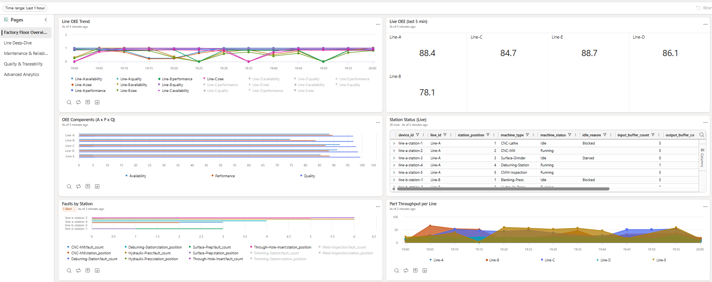

# Fabric OEE Demo

This repository builds a real-time **Overall Equipment Effectiveness (OEE)** demo on Microsoft Fabric. A .NET 10 WPF desktop simulator models a factory floor with **5 production lines and 30 stations**, then streams machine telemetry, part events, and maintenance work orders into Fabric for live dashboards and AI-assisted operations.

The simulator streams telemetry into Fabric through a Fabric Eventstream custom endpoint (Event Hubs protocol): Simulator -> Fabric Eventstream -> Eventhouse/KQL -> Dashboard. OEE is composed from Silver KQL tables at query time: **Availability x Performance x Quality**. There is no precomputed OEE table or materialized view.



## What It Builds

- **Simulator:** Windows .NET 10 WPF desktop app with a live factory-floor visualization, cascading faults, bounded buffers, part traceability, and maintenance work orders.
- **Fabric RTI:** Eventstream, Eventhouse, KQL database, Bronze raw tables, Silver enriched tables, reference tables, OneLake mirroring, and a five-page Real-Time Dashboard.
- **Optional Fabric IQ:** Fabric Ontology plus Data Agent over live KQL and graph-shaped operational context.
- **Optional AI layer:** Foundry resource, chat and embedding model deployments, Azure AI Search over 36 SOP PDFs, and a Foundry prompt agent that routes between live telemetry and SOP knowledge.

## Architecture

```text
                         +-------------------------------+
                         | .NET WPF OEE Simulator        |
                         | 5 lines / 30 stations         |
                         +---------------+---------------+
                                         |
                                Event Hubs protocol
                                         |
                         +---------------v---------------+
                         | Fabric Eventstream             |
                         | routes by event_type           |
                         +---------------+---------------+
                                         |
                         +---------------v---------------+
                         | ManufacturingEH Eventhouse/KQL |
                         | Bronze *_Raw tables            |
                         | Silver enriched tables         |
                         | reference/master data          |
                         +------+------------------+------+
                                |                  |
                    +-----------v-----+    +-------v--------+
                    | RT Dashboard    |    | Fabric Ontology |
                    | Activator-ready |    | Data Agent      |
                    +-----------------+    +-------+--------+
                                                   |
                                   +---------------v---------------+
                                   | Foundry Agent Service          |
                                   | + Azure AI Search SOP corpus   |
                                   +-------------------------------+
```

## Prerequisites

Required for the core Fabric path:

- Microsoft Fabric capacity (F2 or higher) with Real-Time Intelligence enabled.
- A Fabric workspace where you have contributor access.
- Azure CLI 2.x logged in with `az login`.
- `bash`, `jq`, and `curl` available from Git Bash, WSL, Linux, or macOS.
- [.NET 10 SDK](https://dotnet.microsoft.com/download/dotnet/10.0) on Windows to build and run the WPF desktop simulator.

Additional prerequisites for the optional AI stack:

- **Azure CLI 2.67 or later** — `scripts/4-setup-foundry.sh` uses `--allow-project-management` and the `az cognitiveservices account project` subcommands, which older builds (e.g. 2.58) reject. Upgrade with `az upgrade`.
- Permission to create a Microsoft Foundry resource and project.
- **Consumption (pay-as-you-go) model quota — no PTU.** Deployments default to the `GlobalStandard` SKU. You need `GlobalStandard` quota for a chat model and for `text-embedding-3-large` in your region. Note: some subscriptions have **no consumption quota for `gpt-4.1`** in a given region (only Batch) — `gpt-4o` (version `2024-11-20`) on `GlobalStandard` is a widely available fallback and is what the agent script defaults to.
- Python 3.10+ with `pyyaml` (ontology publishing) and, for the scripted Foundry agent, `azure-ai-projects` (2.x) + `azure-identity` (`pip install azure-ai-projects azure-identity openai httpx` — `httpx`/`openai` cover a transitive import and the `--smoke` test).

## Setup

Clone the repo and authenticate first:

```bash
git clone https://github.com/howardginsburg/FabricOEEDemo.git
cd FabricOEEDemo
az login
```

> **Tip:** Run `bash scripts/0-check-prereqs.sh` first. It verifies every prerequisite (Azure CLI login, `jq`, `python3` + `pyyaml`, the .NET SDK) and prints exact remediation commands for anything missing.

### 1. Provision the Fabric Foundation

This step is required. It creates `ManufacturingEH`, the KQL database, `ManufacturingLH`, raw and enriched tables, reference data, update policies, OneLake mirroring policies, Eventstream routing, lakehouse shortcuts for the ontology path, and the Real-Time Dashboard. It also creates the **Fabric IQ ontology** and the **OEE Data Agent** (draft) automatically — pass `--skip-fabric-iq` to opt out, or omit it if `python3`/`pyyaml` are unavailable (the script skips that part with a warning).

```bash
bash scripts/1-setup-fabric.sh --workspace-name "<FABRIC_WORKSPACE>"
```

After it completes, open the `manufacturing-telemetry` Eventstream in Fabric and confirm it is **Running**. If it is stopped or in draft state, click **Publish**. The script also prints the remaining manual portal steps for the Data Agent (see step 3).

### 2. Get the Eventstream Connection String

In the Fabric Eventstream, open the `oee-simulator` custom endpoint source and copy the primary connection string. Keep it handy — you will use it when you run the simulator in the final step.

### 3. Add Fabric IQ: Ontology and Data Agent (Optional)

Enable this when you want natural-language queries over the live operations model. **Step 1 already creates the ontology and the `OEE Data Agent` (draft) for you** (unless you passed `--skip-fabric-iq`). Two actions remain, and they must be done in the **Fabric portal** — the Fabric *public* REST API has no endpoint to attach an ontology datasource or to publish a Data Agent:

1. In Fabric, open the **OEE Data Agent**.
2. **Add data source → Ontology**, and select **`OEEManufacturingOntology`**. (The KQL source `ManufacturingEH` and the agent instructions are already configured.)
3. Click **Publish** to make the agent queryable.

> The ontology relies on OneLake availability for the `ManufacturingEH` KQL Database. Step 1 enables the mirroring/shortcuts automatically, but if the ontology shows no data, open **ManufacturingEH → Settings → Database details → OneLake availability** to confirm it is on, wait 2-3 minutes, then re-run `scripts/1-setup-fabric.sh`.

If you ran Step 1 with `--skip-fabric-iq` (or without Python), create the ontology and Data Agent manually before doing the portal steps above:

```bash
pip install pyyaml
python scripts/6-publish-ontology.py  --workspace-name "<FABRIC_WORKSPACE>"
python scripts/7-setup-data-agent.py --workspace-name "<FABRIC_WORKSPACE>" --data-agent-name "OEE Data Agent"
```

### 4. Add SOP Search and Foundry Agent (Optional)

Run these after the Data Agent if you want the full assistant experience.

1. Provision Foundry and deploy the chat + embedding models:

   ```bash
   bash scripts/4-setup-foundry.sh \
     --foundry-resource <FOUNDRY_RESOURCE_NAME> \
     --project <FOUNDRY_PROJECT_NAME> \
     --resource-group <RESOURCE_GROUP> \
     --location <AZURE_REGION>
   ```

   Deployments use the `GlobalStandard` (consumption) SKU by default — no PTU. The script runs a quota preflight and, if the default `gpt-4.1` has no consumption quota in your region, prints the exact override. To force the widely available fallback: add `--chat-model gpt-4o --chat-model-version 2024-11-20`.

2. Provision Azure AI Search and index the SOP PDFs:

   ```bash
   bash scripts/5-setup-aisearch.sh \
     --resource-group <RESOURCE_GROUP> \
     --location <AZURE_REGION> \
     --search-service <UNIQUE_SEARCH_SERVICE_NAME> \
     --foundry-aoai-endpoint https://<FOUNDRY_OPENAI_SUBDOMAIN>.openai.azure.com
   ```

   Tips: pass `--storage-account <NAME>` so re-runs reuse one account instead of creating orphans. If your region is capacity-constrained for AI Search (`InsufficientResourcesAvailable`), put the search service in another region with `--search-location <REGION>` — it reads storage and calls AOAI cross-region. If an Azure Policy disables storage public network access, the script re-enables it (uploads/indexer use your Entra identity over the public endpoint).

3. Create the prompt agent and wire both knowledge sources (**now scripted** — formerly manual portal steps):

   ```bash
   python scripts/8-setup-foundry-agent.py \
     --foundry-resource <FOUNDRY_RESOURCE_NAME> \
     --project <FOUNDRY_PROJECT_NAME> \
     --resource-group <RESOURCE_GROUP> \
     --search-service <SEARCH_SERVICE_NAME> \
     --fabric-workspace-id <WORKSPACE_GUID> \
     --fabric-artifact-id <DATA_AGENT_GUID> \
     --smoke
   ```

   This creates the two project connections (Azure AI Search + Fabric Data Agent) and a `PromptAgentDefinition` agent (default name `oee-factory-iq`, model `gpt-4o`) whose tools are the AI Search `oee-sops` index and the `MicrosoftFabricPreviewTool`, using [agent/system-prompt.md](agent/system-prompt.md). The Fabric workspace/artifact GUIDs come from the published data agent URL: `https://<env>.fabric.microsoft.com/groups/<workspace-id>/aiskills/<artifact-id>`. `--smoke` runs one SOP and one live-telemetry question to verify both tools.

   The Fabric tool uses **identity passthrough (On-Behalf-Of)**: you (and any demo user) must have READ on the OEE Data Agent and its underlying sources. Prefer the portal instead? Open `https://ai.azure.com` → your project → Agents, attach an Azure AI Search knowledge source (index `oee-sops`, semantic config `oee-semantic`) and a Microsoft Fabric connection (workspace + artifact), and paste [agent/system-prompt.md](agent/system-prompt.md) as the system message. See [agent/knowledge/fabric_data_agent.md](agent/knowledge/fabric_data_agent.md), [agent/knowledge/aisearch_sops.md](agent/knowledge/aisearch_sops.md), and [agent/samples/queries.md](agent/samples/queries.md).

### 5. Run the Simulator

This is the final step. With the Fabric foundation (and any optional setup) in place, configure the simulator with the Eventstream connection string and start it.

The simulator is a Windows desktop (WPF) app. Run it from the repo on a Windows machine:

```bash
cd simulator/FabricOEESimulator.Wpf
```

Create `simulator.local.yaml` next to `simulator.yaml`:

```yaml
simulator:
  broker:
    connection: "Endpoint=sb://...;EntityPath=es_..."
    hub: "es_..." # optional when EntityPath is already in the connection string
```

Then launch the desktop app and click **Start**:

```bash
dotnet run
```

## Script Reference

| Script | Purpose | Run When |
|---|---|---|
| `scripts/1-setup-fabric.sh` | Creates the Fabric RTI foundation: Eventhouse, KQL DB, tables, update policies, Eventstream, dashboard, lakehouse, and ontology shortcuts. | Always first. Re-run after enabling OneLake availability. |
| `scripts/4-setup-foundry.sh` | Creates Foundry resource/project and deploys chat + embedding models (GlobalStandard/consumption, no PTU) with a quota preflight. Needs Azure CLI 2.67+. | Optional AI stack, before AI Search. |
| `scripts/5-setup-aisearch.sh` | Creates storage, uploads SOP PDFs, creates AI Search index/skillset/indexer. Handles storage public-network-access, `--search-location` region fallback, and RBAC-propagation retries. | Optional AI stack, after Foundry. |
| `scripts/6-publish-ontology.py` | Validates and publishes `ontology/ontology.yaml`. | Optional Fabric IQ stack. |
| `scripts/7-setup-data-agent.py` | Creates or updates the Fabric Data Agent draft. | Optional Fabric IQ stack; publish in portal after running. |
| `scripts/8-setup-foundry-agent.py` | Creates the AI Search + Fabric project connections and the OEE Factory IQ prompt agent (both tools). Needs `azure-ai-projects` + `azure-identity`. | Optional AI stack, after AI Search and after publishing the Fabric Data Agent. |
| `scripts/build-sops.sh` | Regenerates SOP PDFs from `knowledge/source/*.md`. | Developer-only content refresh. |

All setup scripts are intended to be idempotent. Re-running the relevant script is the normal recovery path after a transient Azure or Fabric failure.

## Repository Map

| Path | Description |
|---|---|
| `simulator/FabricOEESimulator.Wpf/` | Self-contained Windows WPF desktop simulator (simulation engine, telemetry sinks, and UI). |
| `dashboard/oee-dashboard.template.json` | Real-Time Dashboard template imported by script 1. |
| `eventstream_topology.json` | Eventstream topology reference. |
| `ontology/` | Fabric Ontology manifest and notes; current graph shape is 6 entities and 5 relationships. |
| `knowledge/` | SOP PDFs plus Markdown sources under `knowledge/source/`. |
| `agent/` | Foundry prompt-agent source files, knowledge descriptions, and sample queries. |
| `docs/ONTOLOGY_LESSONS.md` | Rationale for the slim ontology and OEE composition design. |
| `scripts/` | Provisioning and deployment scripts. |

## Operations Notes

- The Eventstream may need a manual **Publish** click after script 1.
- `simulator.local.yaml` is ignored by git; use it for local secrets.
- OEE is composed from live Silver tables. Do not create or depend on an `OEE_5min` materialized view.

### AI stack — lessons learned

- **Azure CLI 2.67+** is required for the Foundry scripts (`--allow-project-management`, `az cognitiveservices account project`). Run `az upgrade` if `scripts/4-setup-foundry.sh` reports an "unrecognized arguments" or version error.
- **Consumption only, no PTU.** Model deployments use `GlobalStandard` (token-based). If `gpt-4.1` has no consumption quota in your region (some subscriptions only expose Batch), the script's quota preflight tells you; use `--chat-model gpt-4o --chat-model-version 2024-11-20`.
- **AI Search capacity:** if a region returns `InsufficientResourcesAvailable`, deploy the search service in another region via `--search-location`. It reads storage and calls the AOAI embedding endpoint cross-region.
- **Storage public network access:** if an Azure Policy disables it, AAD uploads and the indexer fail with a 403 that the CLI mis-reports as "blocked by network rules". Script 5 creates the account with public access enabled and re-enables it if a policy flipped it; if a policy hard-enforces Disabled, an admin must allow it (or add your client IP to the storage firewall).
- **RBAC propagation:** the Search managed identity's `Storage Blob Data Reader` grant can take a couple of minutes to reach the storage data plane, so the first indexer run may 403. Script 5 retries the indexer to absorb this.
- **Role assignments:** in environments where `az role assignment` returns `MissingSubscription`, script 5 falls back to the ARM REST role-assignment API automatically.
- **Foundry connections** occasionally return a transient HTTP 500 (`ServiceError`) from the account resource provider; `scripts/8-setup-foundry-agent.py` retries connection PUTs.
- **Fabric tool auth:** the Fabric Data Agent tool uses identity passthrough (On-Behalf-Of). Every user of the agent needs READ on the data agent and its underlying data sources; service-principal auth is not supported. The Fabric Data Agent must be **published** first.
