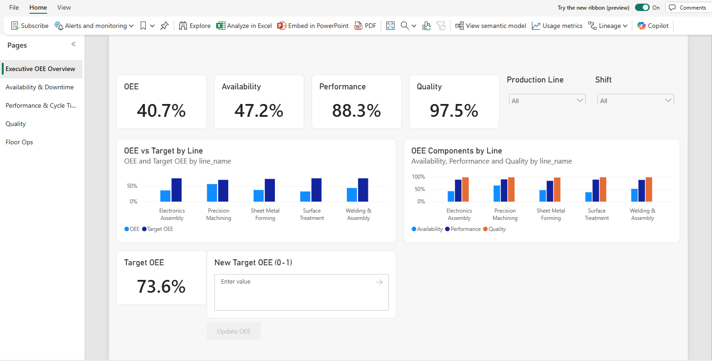
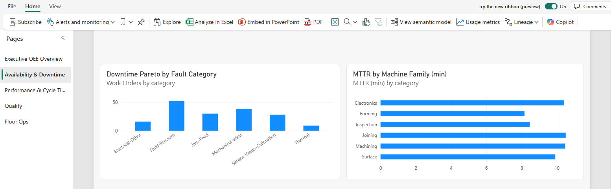
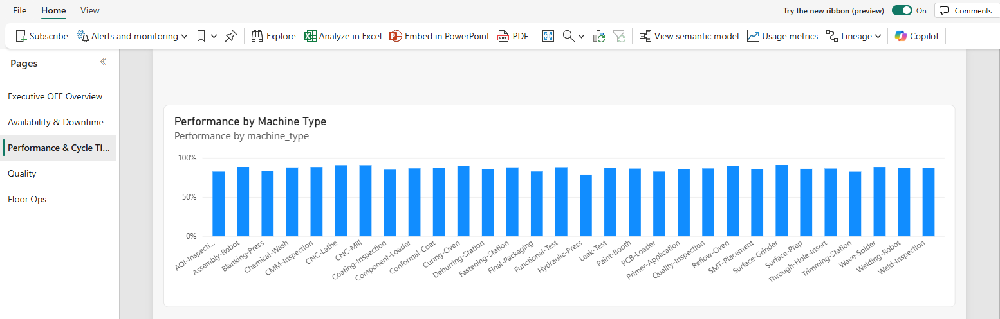
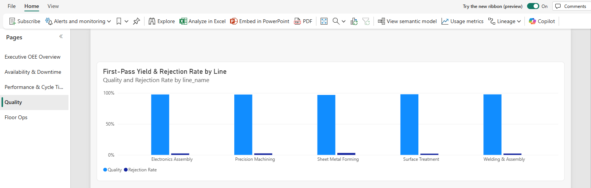
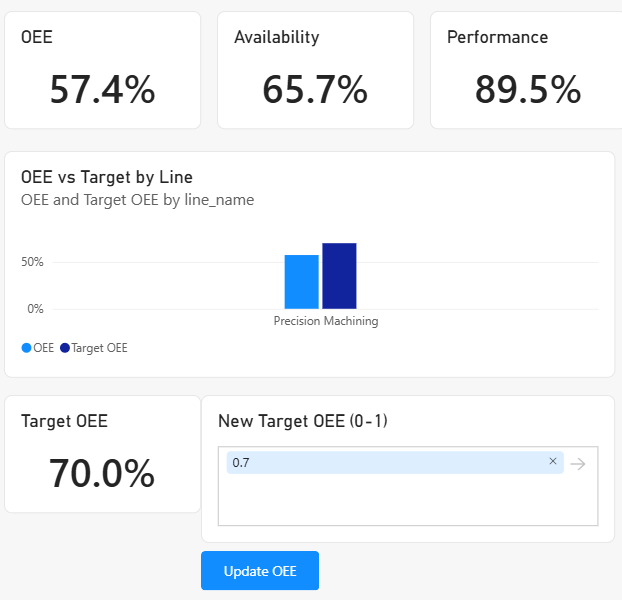

# Analytics and write-back

The `OEEAnalytics` report is Power BI over the same data, minutes behind the stream. It also lets a manager act:
set a line's OEE target from inside the report.

!!! info "Needs"
    Setup steps [3](../setup/write-back.md) (for the write-back) and [5](../setup/power-bi.md)

## The report

Open the `OEEAnalytics` report. Its semantic model uses **Direct Lake on OneLake**: it reads the Delta tables that
the Eventhouse mirrors to OneLake, so there's no import and no refresh schedule. The report covers the whole
history, so a scenario barely moves its numbers; the scenarios show on the Real-Time Dashboard's latest-hour
views.

| Page | Show |
|---|---|
| Executive OEE Overview | OEE and its three components, overall and by line, and each line against its target. Availability is every line's biggest loss. |
| Availability & Downtime | The downtime Pareto by fault category, and MTTR by machine family |
| Performance & Cycle Time | Performance by machine type |
| Quality | First-pass yield and rejection rate by line |
| Floor Ops | The operator-logged issues; see [Floor Ops Console](floor-ops.md) |

=== "Availability & Downtime"

    

=== "Performance & Cycle Time"

    

=== "Quality"

    

!!! quote "What to say"
    "This is the governed view: the same OEE definition as the live dashboard, in a semantic model the whole
    company can use. Direct Lake reads the data straight from OneLake, so there's no copy to refresh."

## Set an OEE target

1. On the **Executive OEE Overview** page, select one line in the **Production Line** filter, such as
   **Precision Machining**.
2. Enter a target as a fraction, such as `0.7`, in **New Target OEE (0-1)**, and select **Update OEE**.
3. After a minute or so, refresh the page. The **Target OEE** card and the **OEE vs Target by Line** chart show
   the new target.

The button calls the `set_oee_target` user data function, which writes the target to the `OeeGovernance` SQL
database. The database mirrors to OneLake, where the model reads it.

!!! quote "What to say"
    "The manager doesn't leave the report to change a target. It's a governed write to a database, and it comes
    back into the model through OneLake. There's no export and no spreadsheet."
