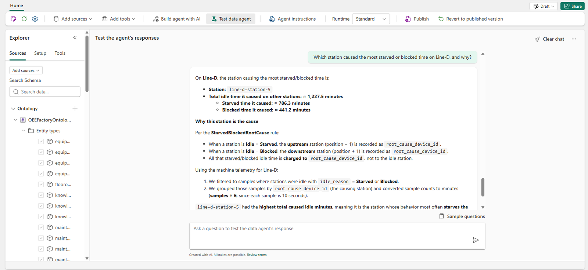
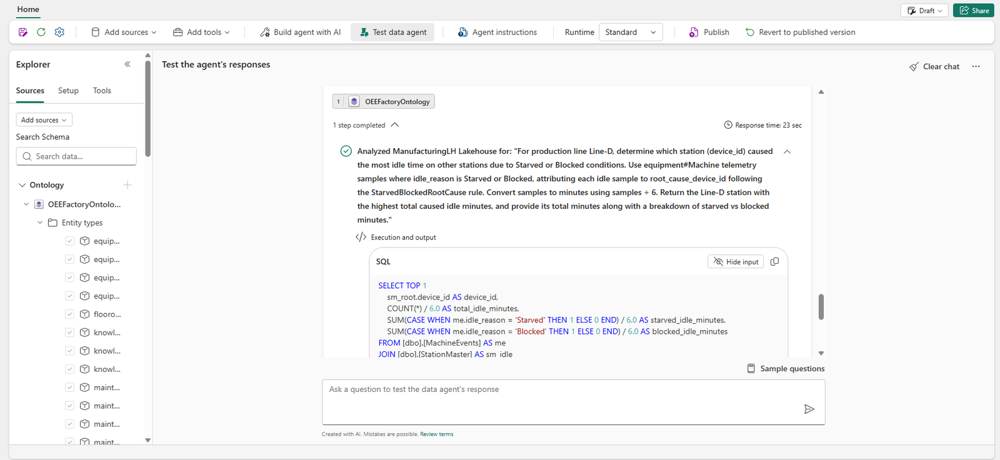

# OEE Data Agent

The OEE Data Agent answers questions in plain language. For each question it picks the right source: the
ontology for what things are, how they connect, and their current state; the semantic model for governed KPIs;
and the Eventhouse for time windows, trends, timelines, and anything from the last few minutes, such as whether a
work order is open. The ontology and the semantic model read OneLake copies of the events, which trail the live
stream by a few minutes.

!!! info "Needs"
    Setup step [7](../setup/fabric-iq.md)

## What to show

Open **OEE Data Agent** in the workspace and ask:

1. "Which station caused the most starved or blocked time on Line-D, and why?" It names line-d-station-5, the
   Curing-Oven and the line's slowest station, with the minutes of starved and blocked time it caused. The agent
   counts idle time against the station that caused it, as the ontology's rule says, not against the station
   that sat idle.
2. "Which lines' OEE has stayed below 60% for more than 15 minutes, and since when?"
3. "What should happen when a line's OEE falls below its target?" The answer comes from the ontology's rules.

Expand **1 step completed** under an answer, open the step, and select **Show input**. You see which source
answered and the query it ran: here the ontology answered with SQL over the lakehouse its entities are bound to.

!!! quote "What to say"
    "Nobody had to know which table holds what. The agent starts from the business model, and it picks the
    database or the semantic model when the question needs a time window or a governed KPI. You can see exactly
    what it ran."

More questions, grouped by persona, are on the [Sample questions](sample-questions.md) page. The ones whose
answer needs only the data agent or the ontology work here too.
