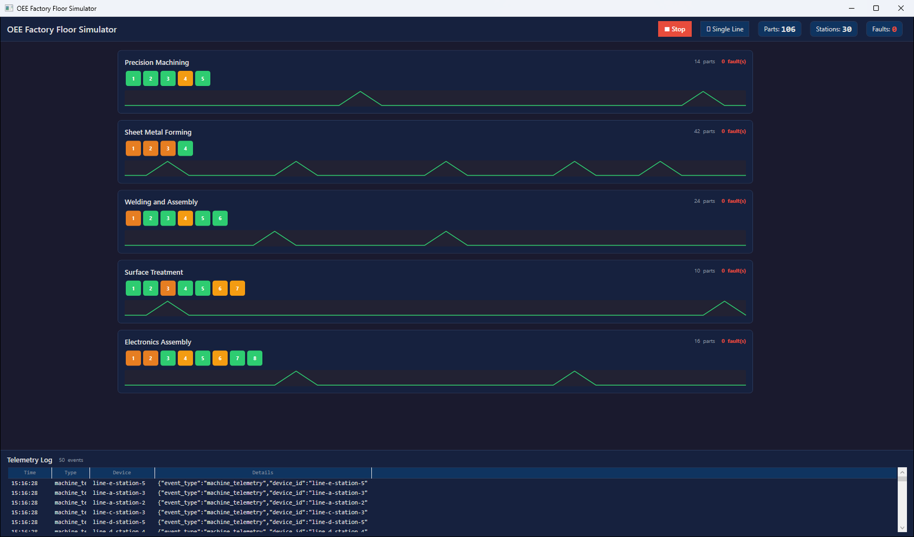
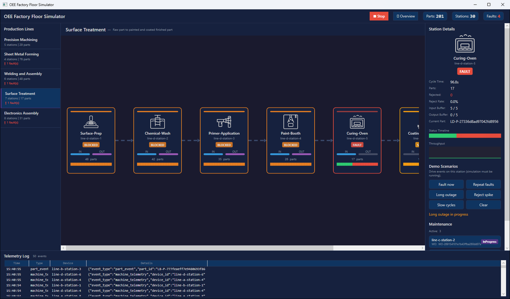

# The factory floor

The simulator stands in for a real plant: five production lines and 30 stations, each reporting its status,
cycle time, and buffers every 10 seconds. Parts flow from each line's first station to its last through
bounded buffers, so trouble spreads the way it does on a real floor. A station that faults starves the stations
downstream of it and blocks the ones upstream.

## What to show

1. **The floor.** Select **Overview** to see all five lines at once, or pick a line under **Production Lines**.
   Each station shows its status, its machine type, and the parts in its input buffer.
2. **The counters** at the top: parts produced, stations, and faults so far.
3. **A station.** Select one to open its **Station Details**: its status, cycle times, and buffer. The
   **Maintenance** panel below lists the open work orders as technicians acknowledge, repair, and resolve them.
4. **The telemetry log** at the bottom: the events going to Fabric as they're sent.

!!! quote "What to say"
    "This is our plant: 30 machines on five lines, streaming to Fabric every 10 seconds. Watch what happens when
    one machine goes down. The stations after it run out of parts, the stations before it fill up and stop, and
    OEE drops on machines that did nothing wrong. Keep that in mind: finding the real cause is where the agents
    come in."

## Demo scenarios

Faults and rejects happen at random, so the **Demo Scenarios** panel lets you cause them on cue. Select a station,
make sure the simulation is running, and choose a scenario. Each one only changes how the station behaves: the
events it sends look like any others, and every layer downstream picks them up on its own. The fault types of
**Repeat faults** and **Long outage** are random, like the natural faults.

| Button | What happens | Shows |
|---|---|---|
| **Fault now** | The station faults at once with the first fault type in its `faultTypes` (for the Line-D Curing-Oven, Thermocouple-Drift), then a technician works a normal work order. | The outage email, the work order on the dashboards, and the open work order the agents find |
| **Repeat faults** | Three faults back to back, each with a quick repair | The preventive maintenance rule: three or more work orders on a station in an hour |
| **Long outage** | One fault, held down for 12 minutes from fault to resolution | The bottleneck rule, when the station is a bottleneck (see below), and a drop in the line's OEE |
| **Reject spike** | The station rejects 35% of its parts for 20 minutes. | The quality quarantine rule, and the Quality part of OEE |
| **Slow cycles** | The station's cycle times stretch 1.8 times for 30 minutes. | The Performance part of OEE, and the station escalation rule |
| **Clear** | Drops queued faults and ends timed scenarios. A fault that's already underway still resolves. | |

The durations give the [operations agent](operations-agent.md), which checks its rules every 5 minutes, time to see
each condition. They're set in the `scenarios:` section of `simulator/FabricOEESimulator.Wpf/simulator.yaml`.

Each line has one **bottleneck**, its slowest station: the Line-A CMM-Inspection, the Line-D Curing-Oven, and the
Line-E Wave-Solder are the ones the bottleneck rule watches. A long outage there stops the whole line.
