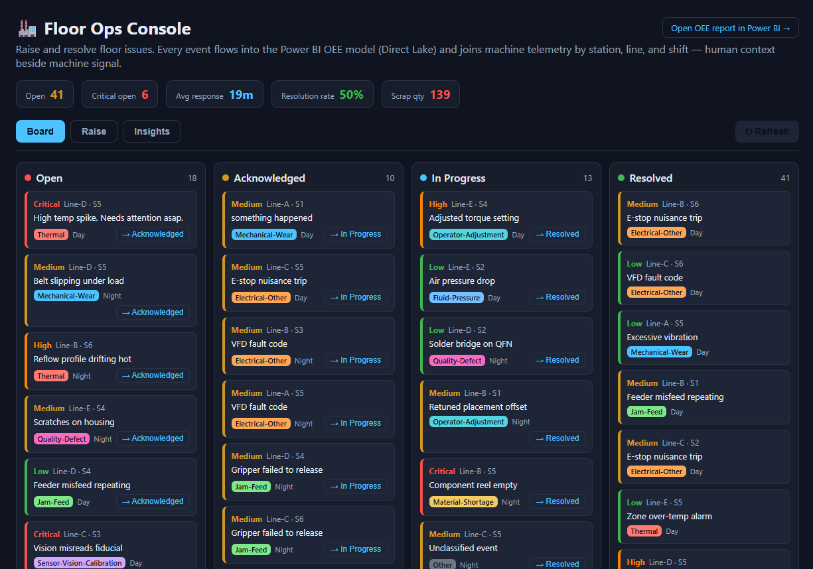
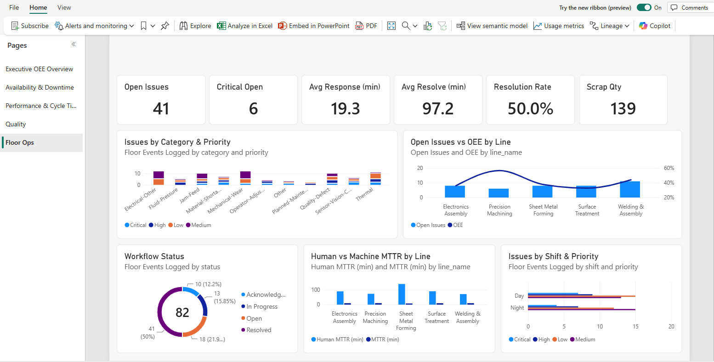

# Floor Ops Console

Machines can't report everything. The Floor Ops Console is a Fabric App where operators raise issues (Andon
calls, quality defects, and shift events) and supervisors work them to resolution. The issues land in the same
semantic model as the machine data.

!!! info "Needs"
    Setup steps [4](../setup/floor-ops-console.md) and [5](../setup/power-bi.md)

## Raise an issue

Open the Floor Ops Console at its hosting URL (see [Verify](../setup/floor-ops-console.md#verify) in setup step 4)
and select **Sign in with Fabric**. On the **Raise** tab, log the Curing-Oven outage:

1. **Line** `Line-D`, **Station** `5`, and the current **Shift**.
2. **Priority** `Critical`, **Category** `Thermal`.
3. A **Description**, such as "Oven zone 2 over temperature; parts held at the paint booth".
4. Select **Raise issue**.

## Work it

On the **Board** tab, the issue appears under **Open**. Move it along with its button: **→ Acknowledged**,
**→ In Progress**, then **→ Resolved**. Each step records its time, which gives the response and resolve times.

The **Insights** tab charts the issues by category, priority, line, and shift.

## See it next to the machine data

Open the **Floor Ops** page of the `OEEAnalytics` report. The same measures are there, joined to the machine data by
line, station, and shift. **Human vs Machine MTTR by Line** compares how long people take to resolve issues with
how long machines take to come back.

New issues reach the report a few minutes after they're raised, once the app's database mirrors to OneLake.

!!! quote "What to say"
    "The app writes only to its own database; it has no integration code. Fabric mirrors that database into
    OneLake, and the issues sit next to the telemetry in the same model, so the floor and the boardroom see the
    same numbers."
