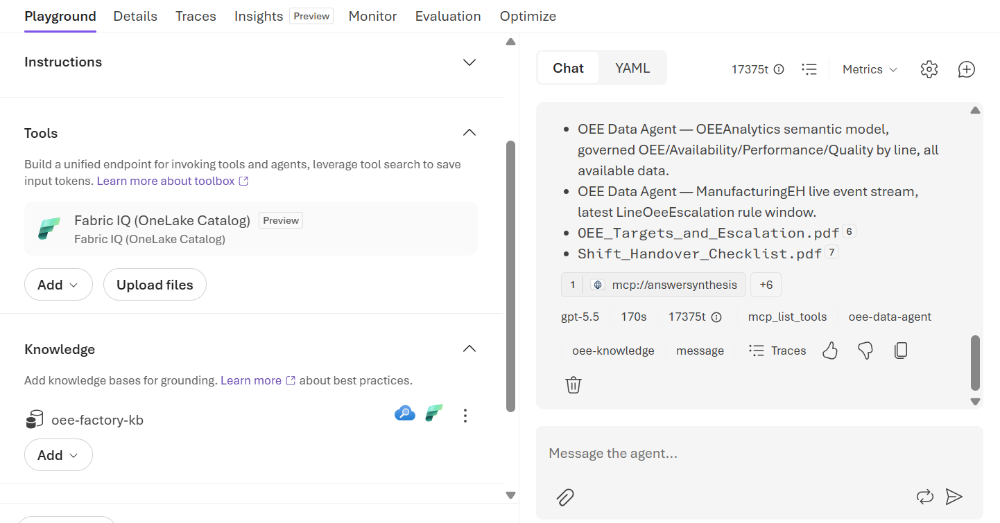
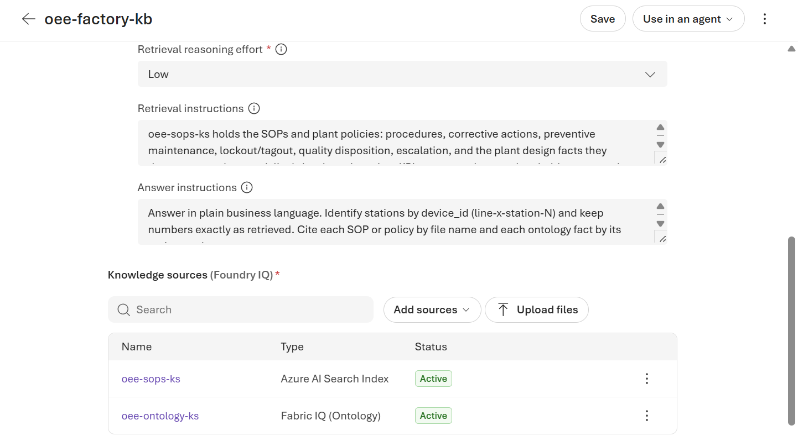
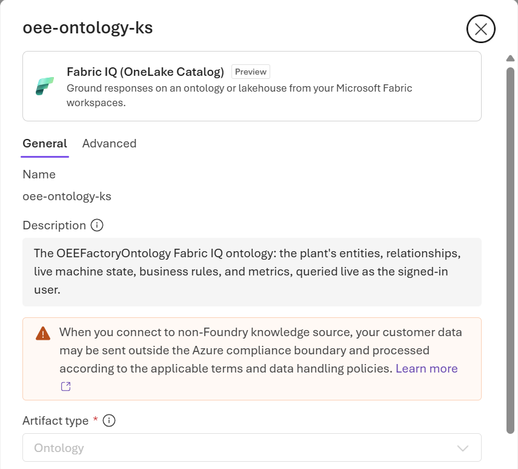
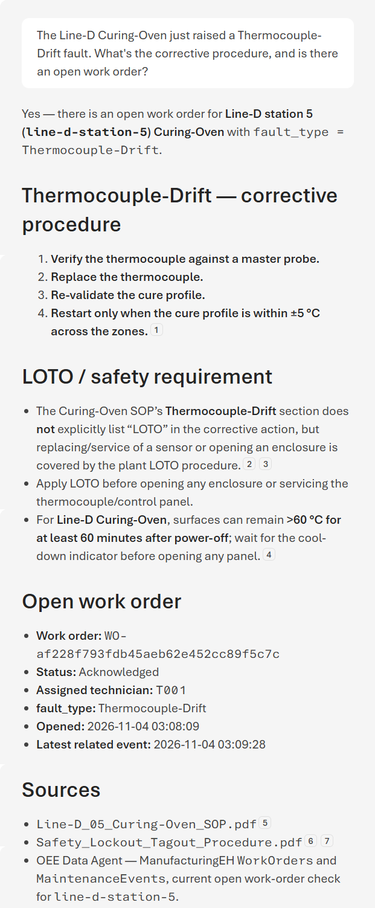
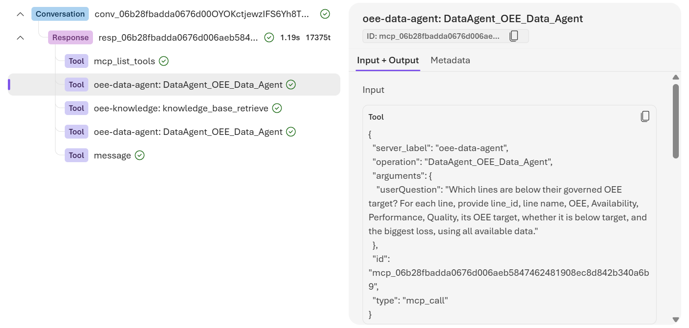
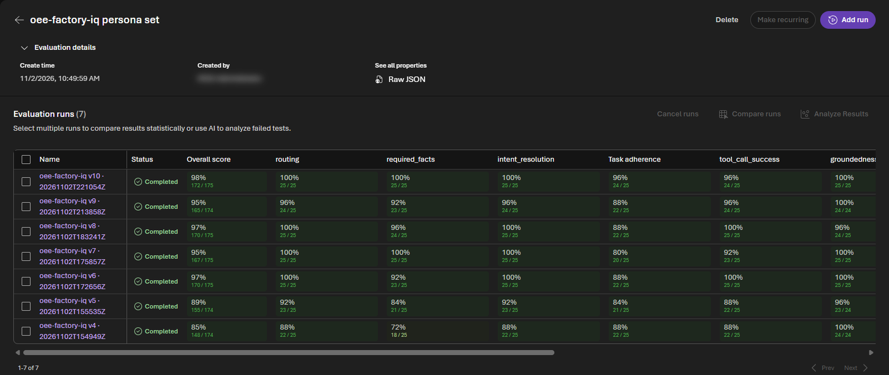

# Foundry agent

OEE Factory IQ is a Microsoft Foundry agent for the plant's six personas. It combines the plant's procedures and
policies with its live data in one answer: a Foundry IQ knowledge base searches the SOPs and the Fabric IQ
ontology, and the OEE Data Agent answers the numbers. This page tours the agent and its knowledge base, then asks
it questions that use each part, and shows how to see what it did.

!!! info "Needs"
    Setup steps [9](../setup/foundry-agent.md), and [10](../setup/evaluate.md) for the evaluations. Keep the
    simulator running for the last question, which looks up a work order the simulator opens.

Open the [Foundry portal](https://ai.azure.com), turn on **New Foundry** at the top, and select the project.

## The agent

Select **Agents** > **oee-factory-iq**. The **Playground** shows what the agent is made of:

- **Model**: the chat model from
  [step 9](../setup/foundry-agent.md#create-the-foundry-resource-and-models).
- **Instructions**: the system prompt from
  [agent/system-prompt.md](https://github.com/howardginsburg/FabricOEEDemo/blob/main/agent/system-prompt.md).
  Expand it and scroll to **Routing rules**: numbers go to the data agent; meaning, business rules, procedures,
  and plant design facts go to the knowledge base; and a question that needs both calls each tool for its part.
- **Tools**: **Fabric IQ (OneLake Catalog)** is the OEE Data Agent, published from Fabric.
- **Knowledge**: the `oee-factory-kb` knowledge base. Its two icons show its two kinds of source: an Azure AI
  Search index and Fabric.

The **Details** tab shows the agent's own Microsoft Entra agent identity, the endpoint that apps call it on (the
OpenAI Responses protocol), and **Publish** to Teams and Microsoft 365 Copilot. The demo doesn't publish it.

!!! quote "What to say"
    "The agent itself is small: a model, its instructions, and two tools. The plant's knowledge lives in Fabric
    and in the knowledge base, where other agents and apps can use it too."

## The knowledge base

Select **Knowledge** in the left pane, then `oee-factory-kb`. It's a Foundry IQ knowledge base, hosted in Azure
AI Search:

- **Output mode** is **Answer synthesis**. For each question, the knowledge base plans its searches, runs them
  against its sources, and writes one answer with references. It uses the agent's chat model, at **Low**
  retrieval reasoning effort.
- **Retrieval instructions** say which source answers what. Procedures, corrective actions, policies, and plant
  design facts such as bottlenecks and pause thresholds come from the SOPs. Facts about the plant, and what a
  business rule says, come from the ontology, but never KPIs: those are the data agent's. **Answer
  instructions** ask it to cite each SOP by file name and each ontology fact by its entity or rule.
- **Knowledge sources**: `oee-sops-ks` is the `oee-sops` index of the SOP and policy PDFs, which
  [step 9](../setup/foundry-agent.md#index-the-sops) builds in Azure AI Search. `oee-ontology-ks` is the Fabric IQ
  ontology.

Select `oee-ontology-ks` to open the source. Its artifact type is **Ontology**, and its workspace and ontology IDs
point at `OEEFactoryOntology`, the same ontology the OEE Data Agent queries. The knowledge base queries it when it
answers, rather than indexing a copy. Select **Cancel** to close it without changes.

{ width="480" }

!!! quote "What to say"
    "We modeled the plant once, in Fabric. Here that model is simply a knowledge source next to the documents, and
    the knowledge base decides which one to search for each question."

## Ask the agent

Back in the agent's **Playground**, ask these questions, starting each one with **New chat**. Answers that call
the data agent take one to three minutes. Just before the last question, fire **Fault now** on the Line-D
Curing-Oven in the simulator: it raises a Thermocouple-Drift fault, and the work order stays open for about 10
minutes.

| Ask | Answered by | Point out |
|---|---|---|
| "Walk me through the LOTO procedure for the Line-B Hydraulic-Press." | The knowledge base, from the lockout/tagout procedure and the press's SOP | The 7-step LOTO sequence, the procedure's warning to bleed the press's accumulator before opening the ram enclosure, and the citations |
| "What does our business rule say when a station's reject rate climbs above twice its target, and what's the target reject rate for the Line-D Curing-Oven?" | The knowledge base: the rule and the oven's target, from the ontology | The rule (when the rolling-hour reject rate exceeds twice the target, the Quality Engineer quarantines the station's buffered parts) and the oven's own target |
| "Which lines are below their OEE target, and what does our escalation policy require for them?" | Both tools: the data agent for each line's OEE against its target, and the knowledge base for the policy | Live KPIs and the policy in one answer |
| "The Line-D Curing-Oven just raised a Thermocouple-Drift fault. What's the corrective procedure, and is there an open work order?" | Both tools: the SOP's procedure from the knowledge base, and the open work order from the data agent, which reads it live from the Eventhouse | The work order the simulator just opened, with its ID, status, and technician |

{ width="420" }

!!! quote "What to say"
    "The technician asks one question and gets the procedure and the current state of the machine together, with
    sources."

### See how it answered

The chips under each answer list the tools it called. Select **Traces** under an answer to open the steps behind
it, then select a tool call to see what the agent sent that tool and what came back. The agent rewrites the
question for each tool, and it asks the data agent separately whether an escalation rule has fired, as its
instructions require.

The **Traces**, **Monitor**, and **Insights** tabs at the top of the agent need Application Insights, which the
demo doesn't connect. **Traces** under each answer works without it.

!!! quote "What to say"
    "Nothing here is a black box. For every answer, you can see which tool answered which part, what it was asked,
    and what it returned."

## Who it answers as

The data agent and the ontology answer as the person asking, so each person gets only the Fabric data they have
access to. [Step 9](../setup/foundry-agent.md#create-the-knowledge-base-and-the-agent) lists the access each user
needs.

!!! quote "What to say"
    "The agent acts as the person asking, so Fabric's permissions still apply."

## How we know it's good

Every version of the agent answers the same 25 persona questions. A script checks that it used the right tools
and that its answers contain the required facts, and AI judges in Foundry grade intent, task adherence, tool
calls, groundedness, and completeness. Open **Evaluations** > **oee-factory-iq persona set** in the project to
compare versions.

!!! quote "What to say"
    "We don't guess whether a prompt change helped. Each version runs the same evaluation, and we compare the
    scores side by side."

The questions are on the [Sample questions](sample-questions.md) page, and the
[evaluation README](https://github.com/howardginsburg/FabricOEEDemo/blob/main/agent/evals/README.md) shows what
each round found and fixed.
