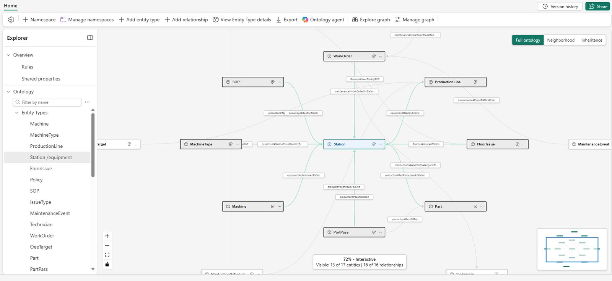
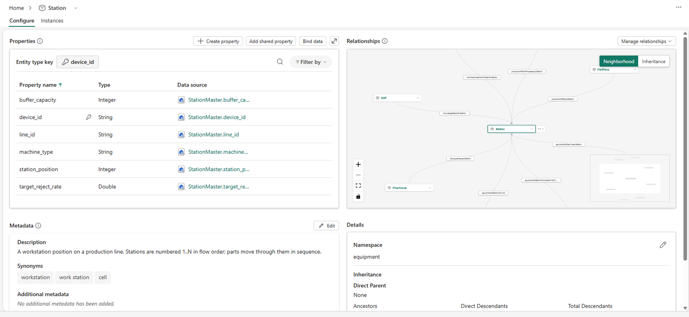
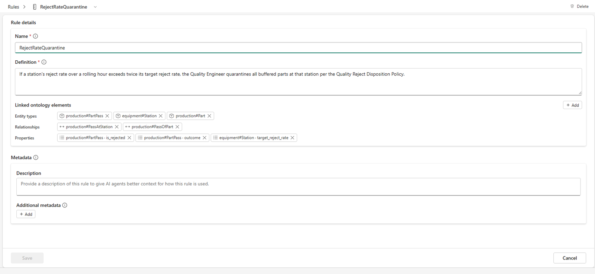
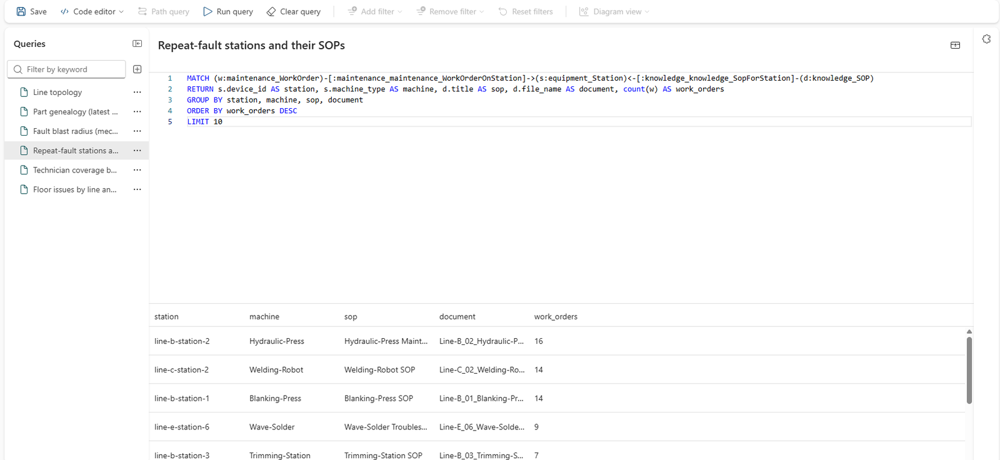

# Ontology and graph

The `OEEFactoryOntology` ontology is the plant's business model: what a station, a work order, or a part pass is,
how they relate, what each business rule requires, and how each KPI is defined. Every agent in the demo reads it.

!!! info "Needs"
    Setup step [7](../setup/fabric-iq.md)

## The model

Open `OEEFactoryOntology`. Its 17 entity types sit in five namespaces:

| Namespace | Entity types |
|---|---|
| `equipment` | ProductionLine, Station, Machine, MachineType |
| `production` | Part, PartPass, Shift, ProductionSchedule, OeeTarget |
| `maintenance` | WorkOrder, MaintenanceEvent, Technician, IssueType |
| `knowledge` | Document, SOP, Policy |
| `floorops` | FloorIssue |

Select **Station** to show its properties, such as `ideal_cycle_time` and `target_reject_rate`, and the lakehouse
table they're bound to. `Machine` adds the live telemetry as time-series properties, whose latest values are each
machine's current state.

!!! quote "What to say"
    "This is the plant in business terms, not tables. Every agent we'll see reads this model, so they all agree on
    what a station or a work order is."

## Rules and metrics

The ontology's 13 rules restate the plant's policies from its SOPs: escalations, quarantines, lockout/tagout,
preventive maintenance, and how idle time is attributed. Each rule names the entities and properties it depends
on. Show **RejectRateQuarantine**, which uses each station's `target_reject_rate`.

Its 9 metrics (OEE, Availability, Performance, Quality, Reject Rate, MTTR, MTBF, Schedule Adherence, and Target
OEE) are SQL definitions, each with a twin measure in the semantic model.

!!! quote "What to say"
    "The rules live here once. The data agent quotes them, and the operations agent enforces them. When the policy
    changes, it changes in one place."

## The graph

The ontology materializes as a graph, where each entity is a node and each relationship an edge. Open the
**OEE Graph Queries** queryset and run its queries:

| Query | Shows |
|---|---|
| Line topology | Each line's stations and machine types, drawn as a graph |
| Part genealogy (latest Line-C parts) | The stations each recent part passed through, in order |
| Fault blast radius (mechanical wear) | The stations with mechanical-wear work orders, and how many parts went through them |
| Repeat-fault stations and their SOPs | The stations with the most work orders, with the SOPs a technician should open |
| Technician coverage by line | Work orders by technician and line |
| Floor issues by line and shift | Operator-logged issues by line, shift, and category |

!!! quote "What to say"
    "Some questions are about connections: which parts went through a station that keeps failing, and which
    procedure covers it. The graph answers those by walking the relationships."
