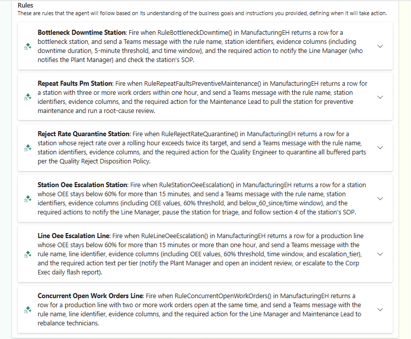
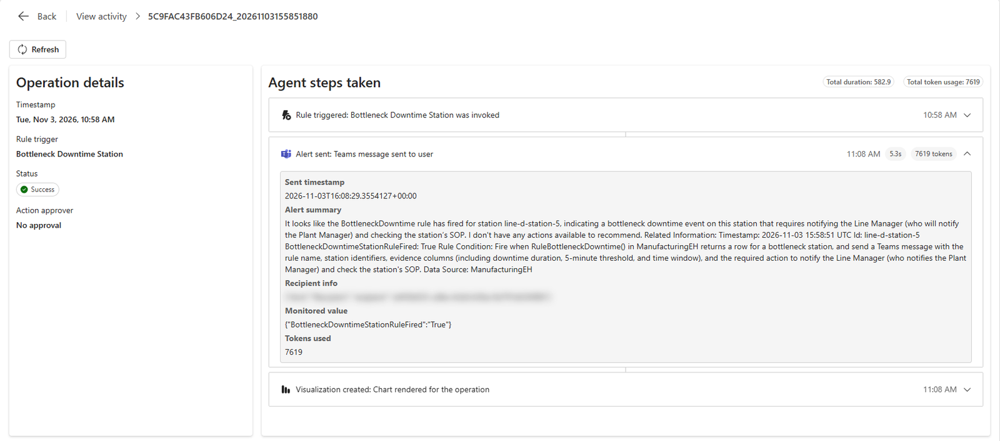

# Operations agent

The OEE Operations Agent works around the clock. About every 5 minutes it checks the ontology's alert rules
against the live Eventhouse. When one fires, it messages the plant's on-call contact in Microsoft Teams with the
rule, the station or line, and what the rule says to do, and it records the alert in its activity log.

!!! info "Needs"
    Setup step [8](../setup/operations-agent.md). Start the agent before you present.

## The rules

| Rule | Fires when | How to trigger it |
|---|---|---|
| BottleneckDowntime | A bottleneck station has been down (in Fault or Maintenance) for more than 5 minutes. | **Long outage** on a bottleneck |
| RepeatFaultsPreventiveMaintenance | A station has had three or more work orders in the last hour. | **Repeat faults** |
| RejectRateQuarantine | A station's reject rate over the last hour is more than twice its target, with at least 3 parts rejected. | **Reject spike** |
| StationOeeEscalation | A station's OEE has stayed below 60% for more than 15 minutes. Starved or blocked time doesn't count against it, because the station that caused it is to blame. | **Slow cycles** |
| LineOeeEscalation | A line's OEE has stayed below 60% for more than 15 minutes, or more than an hour. | Often happens on its own |
| ConcurrentOpenWorkOrders | A line has two or more work orders open at once. | Often happens on its own |

The scenarios are described on [The factory floor](factory-floor.md#demo-scenarios). Each rule is stated once, in
the ontology, and checked by a function in the Eventhouse that returns every reporting station or line and
whether the rule fires for it.

## What to show

1. Open **OEE Operations Agent** in the workspace. Its playbook lists the six rules. Expand one to show the
   query behind it, which calls the rule's check function.

    

2. Select **View activity**. Each row is an alert: the rule, when it fired, and its status. Open an alert from a
   scenario you fired to show the message the agent sent: the rule, the station or line, and the action the rule
   requires. If your tenant has Teams, the same message is in the recipient's chat with the agent.

    

The agent writes its rules and its messages with AI, so their names and wording differ a little from these
screenshots, and from one playbook generation to the next.

!!! quote "What to say"
    "Nobody had to watch a dashboard for this. The agent applies the plant's own rules, the same ones the other
    agents quote, and tells the right person what to do about it."

When you start the agent, it first reports the conditions that are already true, such as a line that has run
below 60% OEE for a while. After that, it alerts once when a condition starts, and again only if the condition
clears and comes back; a line that stays below 60% for more than an hour gets a second alert for the higher
tier. Stop the agent after the demo, because a running agent uses capacity; see [Clean up](../setup/clean-up.md).
