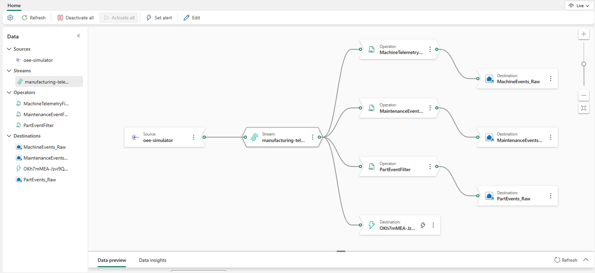
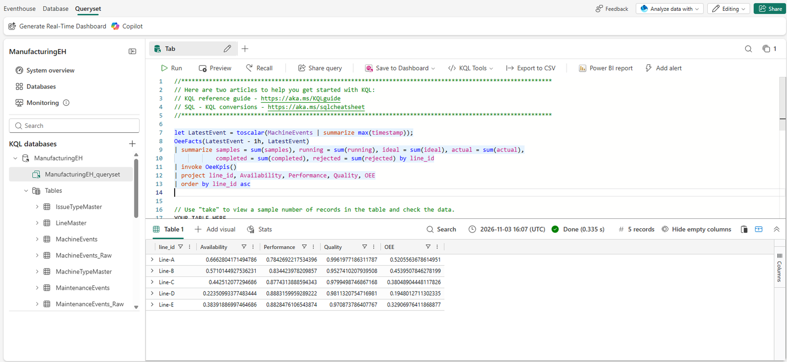
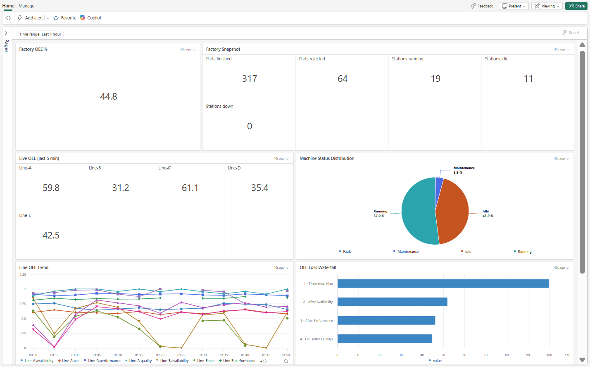
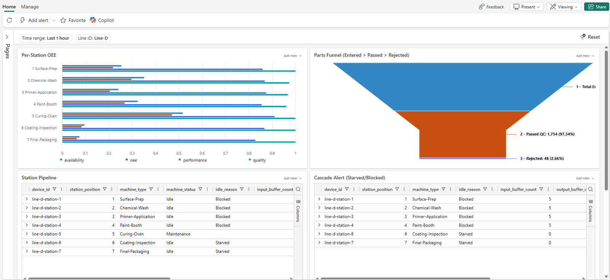
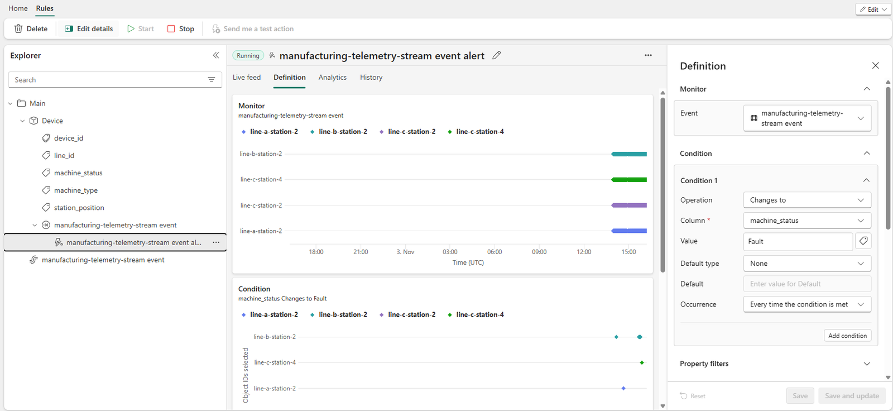
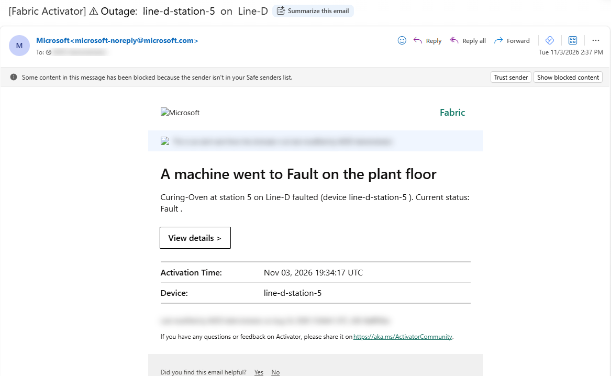

# Real-time operations

The simulator's events land in Fabric within seconds, and three things react: the Eventhouse, the Real-Time
Dashboard, and the Activator alert.

!!! info "Needs"
    Setup steps [1](../setup/fabric-foundation.md), [2](../setup/simulator.md), and
    [6](../setup/activator.md) (for the email)

## The Eventstream

Open the `manufacturing-telemetry` Eventstream. The `oee-simulator` source is a custom endpoint that speaks the
Event Hubs protocol, so the simulator needs only a connection string. Three filters route machine telemetry,
part events, and maintenance events to their own tables in the Eventhouse, and a fourth destination feeds the
Activator.



!!! quote "What to say"
    "There's no ingestion code between the plant and the database. The simulator sends to an endpoint, and the
    Eventstream routes each kind of event to its own table."

## The Eventhouse

Open the `ManufacturingEH` KQL database. The events land in Bronze tables, and update policies turn them into
Silver tables as they arrive, adding the shift and the station that caused any idle time. From the Silver tables,
they build the work order, part, and part pass tables. Everything is mirrored to OneLake for the rest of Fabric.

Run OEE by line for the latest hour of data:

```kusto
let LatestEvent = toscalar(MachineEvents | summarize max(timestamp));
OeeFacts(LatestEvent - 1h, LatestEvent)
| summarize samples = sum(samples), running = sum(running), ideal = sum(ideal), actual = sum(actual),
            completed = sum(completed), rejected = sum(rejected) by line_id
| invoke OeeKpis()
| project line_id, Availability, Performance, Quality, OEE
| order by line_id asc
```



After the long outage, find the station that caused the starved and blocked time on Line-D:

```kusto
MachineEvents
| where timestamp > ago(30m) and line_id == "Line-D" and idle_reason in ("Starved", "Blocked")
| summarize idle_minutes = round(count() / 6.0, 1) by root_cause_device_id, idle_reason
| order by idle_minutes desc
```

!!! quote "What to say"
    "OEE isn't stored anywhere. It's computed when you ask, from one definition that the report and the ontology
    share. And because every idle sample records which station caused it, the Curing-Oven gets the blame for the
    stations it starved and blocked."

## The Real-Time Dashboard

Open **OEE Manufacturing Dashboard**. It has a page for each persona, and its tiles refresh as the data arrives.

| Page | Show |
|---|---|
| Corporate Executive | Factory OEE, a factory snapshot (parts finished and rejected, and stations running, idle, and down), live OEE by line for the last 5 minutes, machine status, the line OEE trend, and the OEE loss waterfall |
| Plant Manager | OEE components by line, throughput, the fault Pareto, and schedule adherence by shift |
| Line Manager | For Line-D after the long outage: OEE by station, the station pipeline, and the starved and blocked cascade |
| Maintenance Technician | Open work orders, their lifecycle, faults by station, and technician workload |
| Quality / Station Worker | Live station status, the rejection rate by station (Line-B's reject spike), and part traceability |





!!! quote "What to say"
    "Every role gets its own view of the same live data, from the factory OEE for the executive to the cascade on
    one line for the line manager."

## The outage email

The **Floor Ops Alerts** Activator watches the Eventstream itself. When a station's status becomes `Fault`, it
emails ops once for that outage, with the machine, the station, and the line.





!!! quote "What to say"
    "This alert doesn't wait for a report or even for the database. It watches the stream, so ops hears about the
    outage within minutes."
