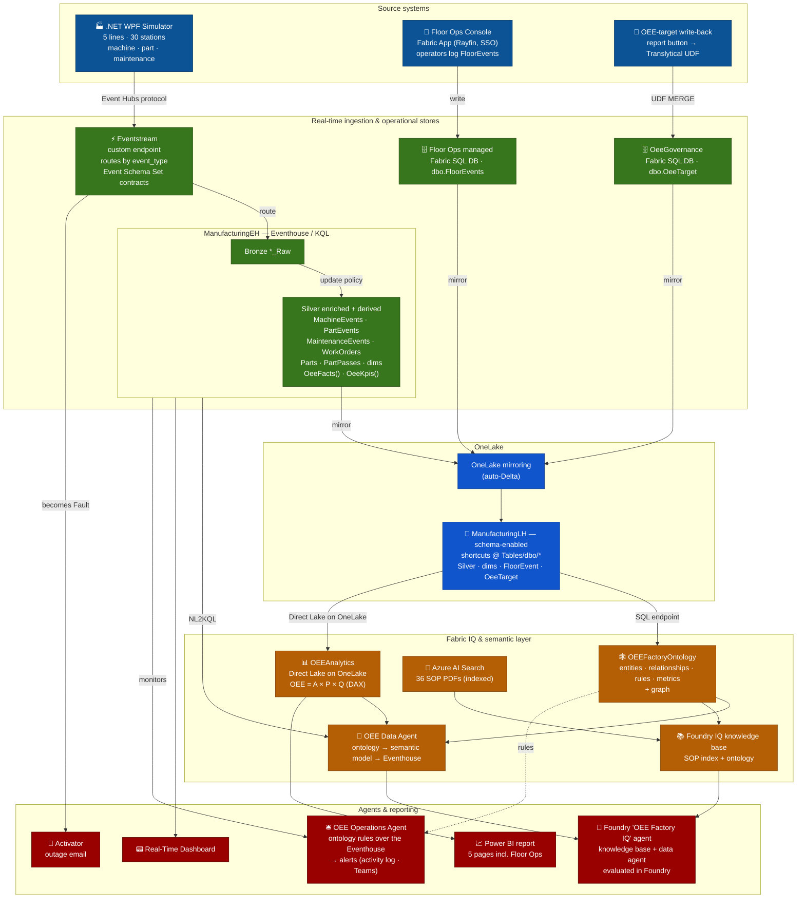

---
hide:
  - navigation
---

# How it works

A simulator streams factory events into Fabric. Real-Time Intelligence lands them, OneLake makes them available
to every other engine, and Fabric IQ gives them business meaning that the reports, alerts, and agents share.

## Architecture

Three sources feed Fabric: streaming telemetry, floor issues that operators log, and OEE targets that managers
set from the report. Each lands in its own store, and everything mirrors into OneLake, where lakehouse
shortcuts bring it together under `ManufacturingLH/Tables/dbo`. The ontology and the semantic model both read
that one surface, and the agents, reports, and alerts at the bottom consume them.

## The data path

- **The simulator** models 5 lines and 30 stations with bounded buffers, cascading faults, part traceability,
  and maintenance work orders. Every station reports every 10 seconds. It sends three event types (machine
  telemetry, part events, and maintenance events) to the Eventstream's custom endpoint over the Event Hubs
  protocol. Their contracts are in `eventschemas/`, published as an Event Schema Set.
- **The Eventstream** routes each event type to its own Bronze `*_Raw` table in the `ManufacturingEH`
  Eventhouse.
- **Update policies** build the Silver tables: they add the shift, status flags, and the station that caused
  an idle, and cascade the keyed `WorkOrders`, `Parts`, and `PartPasses` tables. Streaming ingestion is on, so
  the policies only filter and project. An update policy can't look up another table while streaming ingestion
  is on.
- **OneLake mirroring** exports the Silver, derived, and reference tables as Delta every 5 minutes, and the
  lakehouse shortcuts them.

## One definition per KPI

OEE is computed when you query it, from the same definitions in each layer. There's no precomputed OEE table.

| KPI | Definition |
|---|---|
| Availability | Running samples ÷ all samples, so starved and blocked time counts against it |
| Performance | Ideal cycle time ÷ actual cycle time over running samples, capped at 100% |
| Quality | Parts completed ÷ (completed + rejected) |
| OEE | Availability × Performance × Quality |

| Layer | Where it's defined |
|---|---|
| Eventhouse | `OeeFacts()` returns additive counts per time bucket; `OeeKpis()` turns them into ratios at any grain |
| Semantic model | The measures in `powerbi/OEEAnalytics.SemanticModel/definition/tables/_Measures.tmdl` |
| Ontology | The metrics in `ontology/OEEFactoryOntology.Ontology/metrics/` |

`scripts/6-publish-ontology.py --check-metrics` compares each ontology metric with its DAX twin and reports any
difference.

One check differs on purpose. The operations agent's station escalation follows the plant's policy and leaves
starved and blocked time out of Availability, because that time counts against the station that caused it. With
the measured definition, about half the stations would escalate at any moment because of their neighbors.

## Analytics and write-back

- **Direct Lake on OneLake.** The `OEEAnalytics` model reads the lakehouse's Delta tables directly, with no
  import and no SQL endpoint in the query path. Direct Lake relationships are single-column, so stations are
  keyed on `device_id`.
- **OEE targets.** The report's **Update OEE** button calls the `set_oee_target` user data function, which
  upserts a row in the `OeeGovernance` SQL database. The database mirrors to OneLake, and a shortcut lets the
  model's `Target OEE` measure read it minutes later.
- **Floor issues.** The Floor Ops Console writes only to its own SQL database: a deployed Fabric App signs users
  in with Fabric and can't reach other data sources without an app registration. Fabric does the integration
  instead. The database mirrors to OneLake, and the issues join the model on line, station, and shift.
- **Outage alerts.** The Activator watches the Eventstream itself, so it emails as soon as a station's status
  becomes `Fault`.

## Fabric IQ

The ontology is where the plant's meaning lives: what a station, a work order, or a part pass is, how they
relate, what each business rule requires, and how each KPI is defined. It has 17 entity types in five
namespaces, 16 relationships, 13 rules, and 9 metrics, authored as TMDL in `ontology/` and published by
script 6. Nothing is edited in the portal except materializing the graph.

- **It binds the lakehouse, not the semantic model.** The new ontology experience can bind a semantic model,
  but data agents and operations agents can't use an ontology bound that way, and the graph, the rules, and the
  metrics need keyed physical tables. So the ontology binds `ManufacturingLH` through its SQL analytics
  endpoint, and the semantic model sits beside it as a separate data agent source.
- **Events are entities, and telemetry is a time series.** The keyed tables make work orders and parts
  addressable, and the keyless `PartPass` and `MaintenanceEvent` entities carry part genealogy and work order
  timelines. Each machine's telemetry is a set of time-series properties whose latest value is its current
  state. It trails the Eventhouse by the mirror's 5 minutes.
- **Rules come from the SOPs.** The 13 rules restate the escalation, quarantine, maintenance, safety, and
  attribution policies in the SOP documents, tied to the properties they reference. The data agent gets them in
  its instructions, and the operations agent applies the alert rules.

## The agents

| Agent | Answers from | Notes |
|---|---|---|
| **OEE Data Agent** (Fabric) | The ontology first, then the semantic model, then the Eventhouse | The ontology answers what, which, and who; the model answers governed KPIs; the Eventhouse answers windows, trends, and timelines. Its KQL examples inline `OeeFacts()` and `OeeKpis()`, because its query generator can't see stored functions. |
| **OEE Factory IQ** (Foundry) | A Foundry IQ knowledge base over the SOP index and the ontology, plus the data agent | Numbers go to the data agent, and procedures, rules, and plant design go to the knowledge base. It acts as the signed-in user. |
| **OEE Operations Agent** (Fabric) | The Eventhouse, with the ontology's alert rules | An operations agent over an ontology checks only a property's latest value, and these rules count events or compute rates over a window. Each rule has a `Rule…()` check function in the Eventhouse. |

Script 12 evaluates the Foundry agent on 25 persona questions, with deterministic checks for routing and facts
next to Foundry's AI judges.

## Not included

- **Eventhouse-native time-series bindings.** They're available in the portal, but their TMDL isn't documented,
  so the ontology binds telemetry through the lakehouse.
- **A schema-aware Eventstream.** The event contracts are published as an Event Schema Set, but associating
  them with a stream needs a new Eventstream created in the portal.

## Go deeper

- [Ontology README](https://github.com/howardginsburg/FabricOEEDemo/blob/main/ontology/README.md): the model,
  its bindings, and how to change it.
- [Agent README](https://github.com/howardginsburg/FabricOEEDemo/blob/main/agent/README.md): the Foundry agent's
  tools, routing, and identity.
- [Evaluation README](https://github.com/howardginsburg/FabricOEEDemo/blob/main/agent/evals/README.md): the
  question set, the results of each agent version, and what they found.
- [Floor Ops Console README](https://github.com/howardginsburg/FabricOEEDemo/blob/main/app/README.md): the
  Fabric App's layout and development.
