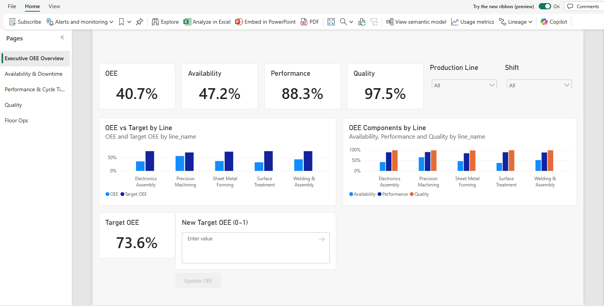

# Fabric OEE Demo

A real-time **Overall Equipment Effectiveness (OEE)** demo on Microsoft Fabric. A Windows simulator runs a
factory floor of **5 production lines and 30 stations** and streams machine telemetry, part events, and
maintenance work orders into Fabric. Everything downstream works from that live stream:

- An **Eventhouse** and a **Real-Time Dashboard** show the floor as it runs, and **Activator** emails ops the
  moment a machine faults.
- A **Direct Lake** Power BI report analyzes OEE by line, shift, and station. Managers set each line's OEE
  target from the report itself, and operators log floor issues in a **Fabric App** that feeds the same report.
- A **Fabric IQ ontology** models the plant: its equipment, parts, work orders, SOPs, business rules, and
  governed metrics. It reads each part from the source that holds it (the lakehouse, live events from the
  Eventhouse, targets from a SQL database, and KPIs from the semantic model), with a graph you can query.
- A **Fabric data agent** and a **Foundry agent** answer questions from the ontology, the data, and 36 SOPs and
  policies. An **operations agent** checks the ontology's alert rules every five minutes and alerts ops when one
  fires.

OEE is **Availability × Performance × Quality**. It's computed at query time from one definition per layer: KQL
functions in the Eventhouse and DAX measures in the semantic model, which the ontology's metrics reference.

## Start here

-   :material-cog-outline: **[Setup](setup/index.md)**

    ---

    Deploy the demo into a Fabric workspace, step by step: the required foundation first, then each optional
    layer.

-   :material-presentation-play: **[Demo](demo/index.md)**

    ---

    What to show and what to say, from the simulator to the reports, alerts, and agents, with a run of show
    for presenting it.

-   :material-sitemap-outline: **[How it works](how-it-works.md)**

    ---

    The architecture, how data flows from the stream to OneLake, and how the ontology grounds the agents.

-   :material-book-open-variant: **[Reference](reference/scripts.md)**

    ---

    Every setup script and its options, capacity sizing and cost, and a map of the repository.

