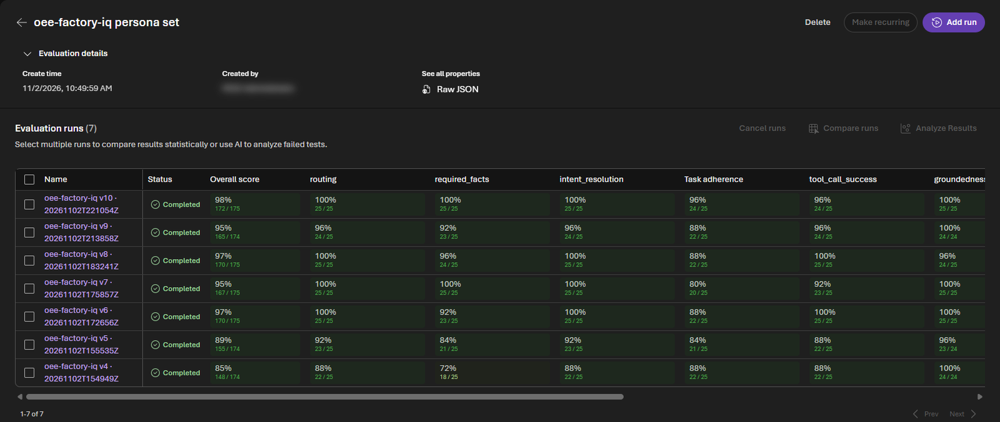

# 10. Evaluate the agent

`scripts/12-evaluate-agent.py` asks the OEE Factory IQ agent 25 questions from six personas, checks each answer,
and has a judge model grade the responses in a Foundry evaluation. Every run is added to the same evaluation,
so you can compare agent versions side by side.

## Run it

```bash
python3 scripts/12-evaluate-agent.py \
  --foundry-resource <FOUNDRY_RESOURCE_NAME> \
  --project <FOUNDRY_PROJECT_NAME> \
  --fabric-workspace "<FABRIC_WORKSPACE>"
```

For each question, the script:

1. Asks the agent as you, the signed-in user, because the agent's Fabric tools act on the caller's behalf.
2. Checks locally that the agent used the right tools (**route**) and that the answer contains the required facts
   (**facts**). Facts that come from the plant's data are read from the Eventhouse at run time.
3. Uploads the responses to the **oee-factory-iq persona set** evaluation, where `gpt-5.4-mini` judges intent
   resolution, task adherence, tool call success, groundedness, and completeness.

A full run takes about 20 minutes to ask the questions and another 5 to 10 minutes to judge. It prints a
scorecard and the link to the run's report.

!!! warning "A full run uses about a third of an F8 for a day"
    Each question reaches the OEE Data Agent, which is billed by token on your Fabric capacity. While you
    iterate, run a subset with `--case <id>` or `--persona <name>`, and re-judge saved responses with
    `--resubmit <results.json>`, which doesn't ask the agent again. See
    [Capacity and cost](../reference/capacity.md).

## Verify

In the Foundry portal, with **New Foundry** on, open the project, then **Evaluations** > **oee-factory-iq persona
set**. Each run is a row, scored by criterion.



The question set, the criteria, and the results of each agent version are in the
[evaluation README](https://github.com/howardginsburg/FabricOEEDemo/blob/main/agent/evals/README.md). The same
questions, grouped by persona, are on the [Sample questions](../demo/sample-questions.md) page.
