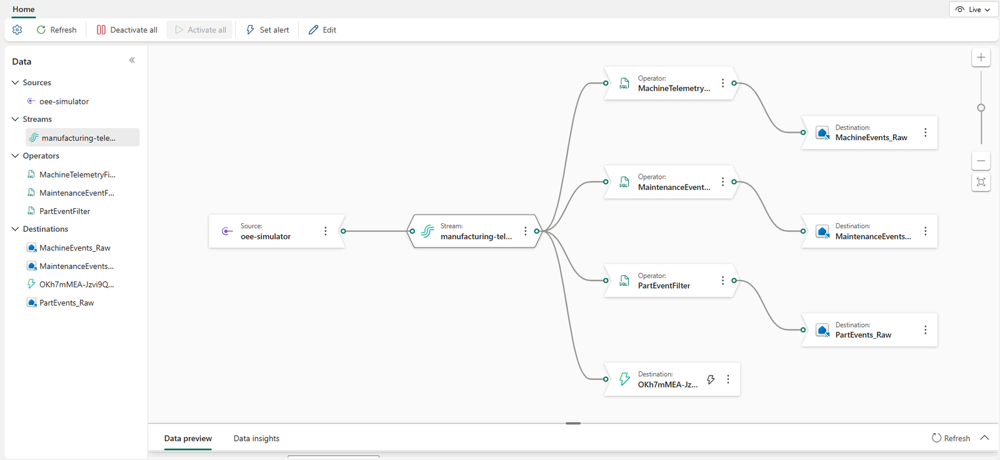

# 1. Fabric foundation

This step is required. One script builds the real-time foundation and the Fabric IQ layer on top of it.

## Run it

```bash
bash scripts/1-setup-fabric.sh --workspace-name "<FABRIC_WORKSPACE>"
```

It runs for several minutes, mostly waiting for Fabric to provision items. Add `--use-device-code` to sign in
with a device code (for example, over SSH), or `--skip-fabric-iq` to leave out the ontology and the data
agent. At the end it asks for the simulator's connection string; you can paste it now or press **Enter** and
do it in [step 2](simulator.md).

## What it creates

| Item | Type | What it holds |
|---|---|---|
| `manufacturing-telemetry` | Eventstream | The `oee-simulator` custom endpoint the simulator sends to, routing each event type to its own table |
| `ManufacturingEH` | Eventhouse and KQL database | Bronze landing tables, Silver tables enriched by update policies, the derived `WorkOrders`, `Parts`, and `PartPasses` tables, reference data, the `OeeFacts()`/`OeeKpis()` OEE functions, and a `Rule…()` check function for each operations agent rule. The Silver and reference tables are mirrored to OneLake. |
| `ManufacturingLH` | Lakehouse (schema-enabled) | OneLake shortcuts to the mirrored tables, under `Tables/dbo` |
| OEE Manufacturing Dashboard | Real-Time Dashboard | Live views for five personas |
| OEE Telemetry Events | Event Schema Set (preview) | The simulator's three event contracts, checked against the landing tables first |
| `OEEFactoryOntology` | Ontology (preview) | The plant's entities, relationships, and rules: the plant's records bound to the lakehouse, and machine telemetry, work order steps, and part passes bound to the Eventhouse |
| OEE Data Agent | Data agent | Answers questions with the ontology as its context, querying the lakehouse and the Eventhouse. It's published. |

The ontology leaves out the entities whose sources come from later steps: the OEE targets (step 3), floor issues
(step 4), and the KPIs from the semantic model (step 5). [Step 7](fabric-iq.md) adds them to the ontology and the
data agent.

## Check the Eventstream

Open the `manufacturing-telemetry` Eventstream. The source and the stream should show **Running**. If the
Eventstream shows a draft, select **Publish**.

Then check the four destinations on the right side of the canvas. A destination can be **Paused** while the
rest of the Eventstream runs, and then no events reach the Eventhouse. Resume them from the Eventstream's
toolbar, or with the API:

```bash
WS_ID=$(az rest --method get --resource https://api.fabric.microsoft.com \
  --url https://api.fabric.microsoft.com/v1/workspaces \
  --query "value[?displayName=='<FABRIC_WORKSPACE>'].id" -o tsv)
ES_ID=$(az rest --method get --resource https://api.fabric.microsoft.com \
  --url "https://api.fabric.microsoft.com/v1/workspaces/$WS_ID/eventstreams" \
  --query "value[?displayName=='manufacturing-telemetry'].id" -o tsv)
az rest --method post --resource https://api.fabric.microsoft.com \
  --url "https://api.fabric.microsoft.com/v1/workspaces/$WS_ID/eventstreams/$ES_ID/resume" \
  --body '{"startType": "Now"}'
```

Destinations take a minute or two to go from **Resuming** to **Running**. Pausing the capacity pauses them
too, and so can throttling, so check them again after either. To also load the events that the simulator sent
while they were paused, use `"startType": "WhenLastStopped"` instead of `"Now"`.



## Verify

- The workspace lists the items in the table above.
- The Real-Time Dashboard opens. Its tiles stay empty until the simulator runs in [step 2](simulator.md).
- The script's summary ends without errors and prints the next steps.

!!! note "Re-running the script"
    Each run reseeds the reference tables. Their OneLake copies are empty for about 7 minutes afterwards, so
    the lakehouse, the ontology, and the data agent briefly show no reference data.
