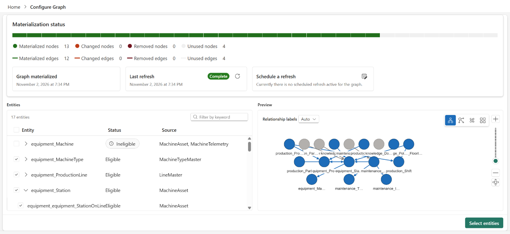

# 7. Fabric IQ

Step 1 already published the `OEEFactoryOntology` ontology and the OEE Data Agent. This step completes them
with what steps 3 to 5 added, and loads the ontology's graph.

## Update the ontology and the data agent

```bash
python3 scripts/6-publish-ontology.py --workspace-name "<FABRIC_WORKSPACE>"
python3 scripts/7-setup-data-agent.py --workspace-name "<FABRIC_WORKSPACE>" --smoke
```

- **Script 6** publishes the ontology from the TMDL in `ontology/OEEFactoryOntology.Ontology/`. This time it
  includes what steps 3 to 5 created: `OeeTarget`, bound to the `OeeGovernance` SQL database; `FloorIssue`; the
  `OeeScorecard` KPIs, which reference the `OEEAnalytics` semantic model's measures; and the ontology's links to
  the Power BI report and the Real-Time Dashboard. It checks that every measure the ontology references exists
  in the model.
- **Script 7** publishes the data agent again, with the ontology as its context. It mounts the Eventhouse and
  the lakehouse under the ontology with their own instructions, runs each of the Eventhouse's example queries to
  check that it still works, and renders the ontology's rules and metric names into the agent's instructions.
  `--smoke` asks one question per kind of source; add `--show-queries` to see the KQL, SQL, or DAX behind each
  answer.

Binding the semantic model, and the agents' queries against it, need Read and Build permissions on
`OEEAnalytics` for whoever runs the scripts and asks the questions.

## Materialize the graph

The ontology's graph starts empty, and loading it is a portal step:

1. Open `OEEFactoryOntology` and select **Manage graph** on the ribbon.
2. On **Configure Graph**, keep **Use the entire Ontology**. The entities that can't be in the graph are left
   out (see below). Select **Continue**.
3. On **Projection Summary**, select **Materialize**.

Loading takes a few minutes. When it's done, **Manage graph** shows the graph's status: the entity types it
materialized, and the ones that can't be in the graph (see below) as unused.



Then run script 6 again, without options: it checks the GQL queries in
`ontology/graph-queries.json` against the graph and saves the ones that pass as the **OEE Graph Queries**
queryset.

```bash
python3 scripts/6-publish-ontology.py --workspace-name "<FABRIC_WORKSPACE>"
```

These entities can't be in the graph:

| Entity | Why |
|---|---|
| `Machine` | Its telemetry is a time series from the Eventhouse. `Station` carries the plant structure in the graph. |
| `PartPass`, `MaintenanceEvent` | Events without a key, read live from the Eventhouse |
| `OeeScorecard` | Its metrics come from the semantic model, which the graph doesn't load |
| `Document` | Abstract: `SOP` and `Policy` inherit from it |

The graph loads lakehouse and mirrored-database tables. `OeeTarget` reads the `OeeGovernance` SQL database, so
**Manage graph** shows whether it can be in the graph; no saved graph query uses it.

!!! warning "The graph is billed per use"
    Graph compute is billed by the second, and loading data is the expensive part. Each publish that changes
    the ontology reloads the graph's data, and so does **Manage graph**. Run **Manage graph** again only when
    you've added a property that the graph should show. To load the latest rows without other changes, use
    `--refresh-graph`. See [Capacity and cost](../reference/capacity.md).

## Verify

- `OEEFactoryOntology` shows 18 entity types. Select `Station` and preview its data.
- The workspace has the **OEE Graph Queries** queryset, and its queries return rows.
- Script 7's `--smoke` output shows an answer for each question, from the source the ontology binds: the
  lakehouse for stations, the Eventhouse for machine status and open work orders, and the semantic model for
  OEE and targets.

To learn how the ontology is built, or to change it, see the
[ontology README](https://github.com/howardginsburg/FabricOEEDemo/blob/main/ontology/README.md).
