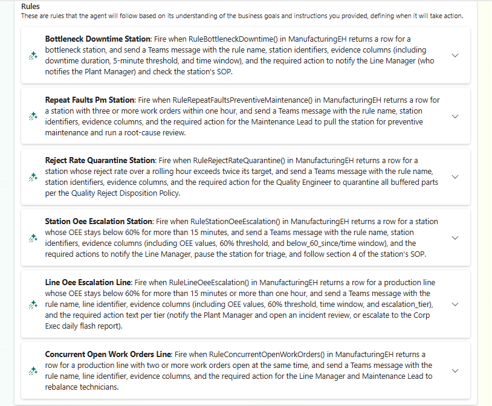

# 8. Operations agent

The **OEE Operations Agent** (preview) watches the plant continuously. About every five minutes it checks the
ontology's alert rules against the live Eventhouse, and when a rule fires it messages the recipient in
Microsoft Teams with the rule, the station or line, and what the rule says to do. Each alert is also recorded in
the agent's activity log.

## Before you start

- To get the alerts in Microsoft Teams, the recipient needs the **Fabric Operations Agent** app in Teams.
  Without Teams, the agent still runs, and you see its alerts in its activity log.
- The capacity can't be a trial capacity. See the
  [operations agent prerequisites](https://learn.microsoft.com/fabric/real-time-intelligence/operations-agent#prerequisites).

## Run it

```bash
python3 scripts/11-setup-operations-agent.py --workspace-name "<FABRIC_WORKSPACE>" \
  --recipient ops@contoso.com
```

Without `--recipient`, the agent messages the account you're signed in with. The script:

1. Creates the agent with `ManufacturingEH` as its knowledge source.
2. Writes the ontology's alert rules into the agent's instructions, and gives each rule its check: a
   `Rule…()` function in the Eventhouse that returns every reporting station or line and whether the rule fires
   for it. The agent alerts when a rule starts firing for a station or line, once per episode.
3. Generates the agent's playbook, the rules it evaluates. This takes several minutes. The script then checks
   that each rule's query calls its check function. Generation doesn't always succeed, so when it fails or a
   rule doesn't call its function, the script generates again, up to three times. It stops instead when the
   capacity is throttled, because generation can't read the functions then; each generation also uses
   capacity.

The agent monitors the Eventhouse rather than the ontology because every alert rule counts events or computes a
rate or an OEE over a time window, and an operations agent over an ontology checks only a property's latest
value. The [Operations agent](../demo/operations-agent.md) demo page lists the rules and the simulator scenario
that fires each one.

## Start and stop it

The script leaves the agent **stopped**, because a running agent uses capacity. Start it before you present and
stop it afterwards:

```bash
python3 scripts/11-setup-operations-agent.py --workspace-name "<FABRIC_WORKSPACE>" --start
python3 scripts/11-setup-operations-agent.py --workspace-name "<FABRIC_WORKSPACE>" --stop
```

!!! warning "Generate the playbook once"
    Playbook generation is the expensive part of the operations agent. The script generates it only when the
    agent has none, or when its rules or source changed. Avoid `--generate-playbook`, which forces it, unless
    you need it. See [Capacity and cost](../reference/capacity.md).

## Verify

Open **OEE Operations Agent** in the workspace. Its playbook lists six rules, and the status is **Stopped**
until you start it.


