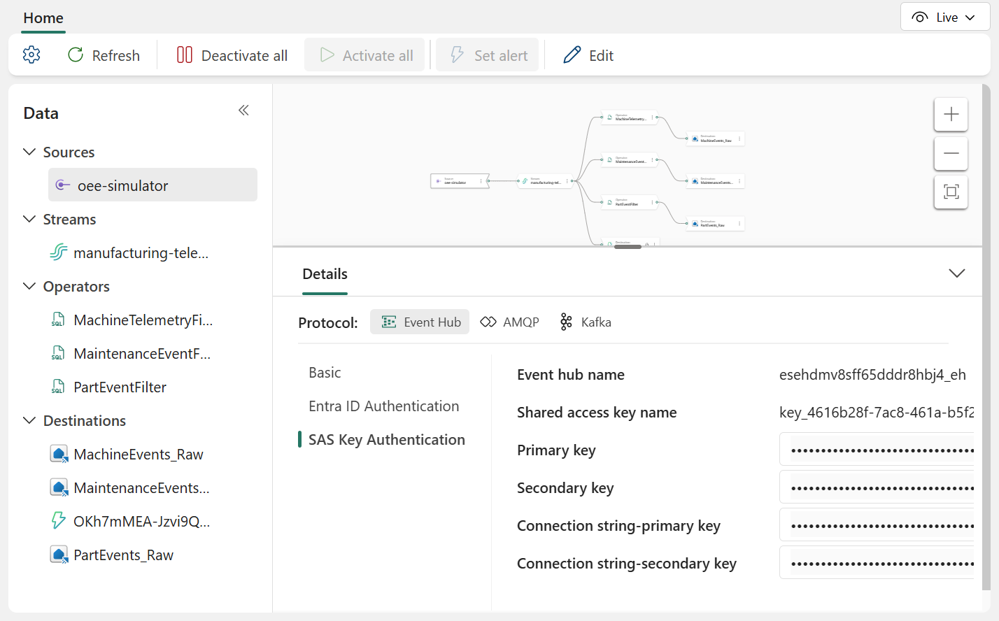

# 2. Connect the simulator

The simulator is a Windows desktop app. It sends its events to the Eventstream's custom endpoint, so it
needs that endpoint's connection string.

## Get the connection string

1. Open the `manufacturing-telemetry` Eventstream and select the **oee-simulator** source.
2. In the **Details** pane, keep the **Event Hub** protocol and select **SAS Key Authentication**.
3. Show **Connection string-primary key** with its eye icon, and copy it.



If you pasted the connection string when step 1 asked for it, the file below already exists; skip to
[Run the simulator](#run-the-simulator).

## Configure it

Create `simulator/FabricOEESimulator.Wpf/simulator.local.yaml`:

```yaml
simulator:
  broker:
    connection: "Endpoint=sb://...;SharedAccessKeyName=...;SharedAccessKey=...;EntityPath=es_..."
```

Git ignores this file, so the key stays on your machine. Everything else comes from `simulator.yaml` next to
it, which you don't need to change:

- `telemetryIntervalSeconds`: how often each station reports (10 seconds).
- `scenarios`: the durations and intensities of the demo scenarios.
- `lines`: the 5 lines and 30 stations, with each station's ideal cycle time, fault and reject probabilities,
  and buffer size.

## Run the simulator

On Windows, from the repository:

```powershell
cd simulator\FabricOEESimulator.Wpf
dotnet run
```

Select **Start**. The floor comes alive: parts move between stations, buffers fill and drain, and a station
that faults starves the stations downstream and blocks the ones upstream.

## Verify

Within a minute, events reach the Eventhouse. In the `ManufacturingEH` KQL database, run:

```kusto
MachineEvents
| where timestamp > ago(5m)
| summarize events = count(), stations = dcount(device_id), latest = max(timestamp) by line_id
```

Each line should list all of its stations (5, 4, 6, 7, and 8 for Line-A to Line-E), at about 6 events per
station per minute, with a `latest` time in the last minute. If nothing arrives, check the Eventstream's
destinations ([step 1](fabric-foundation.md#check-the-eventstream)).

!!! tip "Leave it running"
    The dashboards, the "latest hour" views, and the operations agent work from recent data. Start the
    simulator about an hour before you present; see [Before you present](../demo/index.md).
